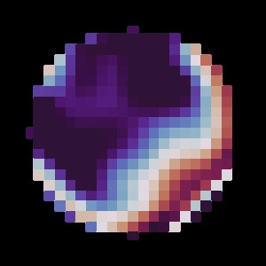

---
# Editable code runs in the reader's browser (Pyodide), not at build time.
engine: markdown
pyodide:
  packages:
    - numpy
    - opencv-python
    - matplotlib
---

# Computational Imaging {#sec-computational-imaging}

```{=html}
<link rel="stylesheet" href="../assets/computational-imaging.css">
```

A traditional camera tries to form the best possible picture optically, and software only cleans it up afterward. **Computational imaging** treats the optics and the algorithm as a single system and designs them together. The image on the sensor may look strange, even worse, to a person. What matters is that the information a robot needs, such as depth, sharpness or brightness range, survives the trip and can be recovered by computation.

This chapter builds the idea from one tool, the **point spread function**, and then tours the main techniques: coded apertures, deconvolution, coded exposure, high dynamic range, light fields and event cameras.

::: {.callout-note appearance="simple"}
**Why this matters for robots.** A single ordinary image cannot tell how far away things are (@sec-intro). Robots often add sensors to measure depth. Computational imaging asks a different question: can a small, passive change to the camera itself make depth, or other hidden information, measurable?
:::

## Single images and the depth problem

From one image we can estimate **relative depth**: which object is in front of which. **Metric depth**, the actual distance in meters, is much harder, because projection divides by depth and the same picture can come from a small near scene or a large far one.

Robots get metric scale in a few ways:

- **Known objects.** Fiducial markers such as AprilTags have a printed size, so their image size gives distance.
- **Other sensors.** Lidar, stereo cameras or an IMU supply scale.
- **The camera itself.** Defocus blur depends on distance (@sec-image-formation). If the blur can be measured, so can depth. This is the route this chapter follows.

## Image formation as convolution

Imagine imaging a single, tiny point of light. A perfect camera would record a single bright pixel. A real camera records a small pattern, called the **point spread function (PSF)**, shaped by the lens, the aperture, focus and diffraction.

Light adds linearly, and over small regions the PSF is roughly the same everywhere. So the image $b$ is the sharp scene $x$ with every point replaced by a copy of the PSF $k$, which is a **convolution**:

$$
b = k * x + n,
$$

where $n$ is sensor noise. In the frequency domain, convolution becomes multiplication:

$$
B(\omega) = K(\omega)\, X(\omega) + N(\omega).
$$

$K(\omega)$, the Fourier transform of the PSF, says how strongly each spatial frequency of the scene survives. Wherever $|K(\omega)|$ is close to zero, that detail is gone, and no algorithm can bring it back. Good optical design keeps $|K|$ away from zero.

### The aperture shapes the PSF

For an out-of-focus point, the PSF is a scaled image of the aperture itself. An ordinary lens has a round opening, so defocus blur is a disc. If we put a patterned mask in the aperture, the blur takes the shape of the mask.

Paint your own aperture below. Click or drag to open and close cells, then compare the blurred image and the frequency response (gold) with an open disc of the same size (gray).

```{=html}
<div class="sim" id="psf-sim">
  <div class="ci-layout">
    <div>
      <div class="ci-grid" aria-label="Aperture mask: click or drag to open and close cells"></div>
      <p class="ci-light"></p>
    </div>
    <div class="ci-outputs">
      <figure><canvas></canvas><figcaption>Image blurred by this aperture</figcaption></figure>
      <figure><canvas class="ci-chart"></canvas><figcaption>Frequency response |K|</figcaption></figure>
    </div>
  </div>
  <div class="sim__controls">
    <span class="sim__group">Aperture
      <button type="button" class="btn btn-gold-outline btn-sm" data-mask="open">Open disc</button>
      <button type="button" class="btn btn-gold-outline btn-sm" data-mask="coded">Coded</button>
      <button type="button" class="btn btn-gold-outline btn-sm" data-mask="ring">Ring</button>
      <button type="button" class="btn btn-gold-outline btn-sm" data-mask="pin">Pinhole</button>
    </span>
    <label>Blur size <input type="range" name="blur" min="3" max="25" step="1" value="13"><output></output></label>
  </div>
  <p class="ci-legend"><span style="--c:#cfb97d">your aperture</span><span style="--c:#969696">open disc</span></p>
  <p class="sim__readout"></p>
</div>
```

Two things to notice. First, the open disc has deep, regularly spaced dips in its frequency response: whole bands of detail vanish. Many coded patterns avoid those dips. Second, every closed cell blocks light. A coded aperture trades brightness for information.

## Depth from defocus

Recall from the thin lens equation that only one distance is in perfect focus. A point at distance $Z$, with the lens focused at $Z_f$, spreads into a blur whose diameter grows with the defocus

$$
\sigma \;\propto\; A \left| \frac{1}{Z} - \frac{1}{Z_f} \right|,
$$

where $A$ is the aperture diameter. Measure the blur size and you can solve for $Z$. The difficulty is measuring it reliably. A blurry patch might be a blurred edge, or a soft object in focus.

The frequency response helps. As the blur grows, the PSF scales up and its frequency response scales down, so its pattern of dips moves. Choose a depth below and compare how three nearby blur sizes look in frequency for an open and a coded aperture.

```{=html}
<div class="sim" id="scale-sim">
  <canvas class="ci-chart"></canvas>
  <p class="ci-legend"><span style="--c:#e36b5b">blur at this depth</span><span style="--c:#5fae6b">1.5 × larger</span><span style="--c:#5a7fd6">2.2 × larger</span></p>
  <div class="sim__controls">
    <span class="sim__group">Aperture
      <button type="button" class="btn btn-gold-outline btn-sm is-on" data-pattern="open">Open</button>
      <button type="button" class="btn btn-gold-outline btn-sm" data-pattern="coded">Coded</button>
    </span>
    <label>Object distance <input type="range" name="depth" min="0.5" max="6" step="0.1" value="3"><output></output></label>
  </div>
  <p class="sim__readout"></p>
</div>
```

This is the core idea of the **coded aperture** for depth (Levin and colleagues, 2007). An asymmetric, irregular mask gives each depth a distinctive blur signature, so depth can be read from a single image with no loss of resolution. The costs: the mask blocks light, and the depth is coarse.

Masks need not be binary. A **phase mask** bends light instead of blocking it, shaping a PSF that changes markedly with depth while losing much less light. The PSF on the right comes from a phase-mask camera used for metric depth and visual odometry in the author's research.

```{=html}

```

Recovering depth from these images is a pattern-recognition problem: given a blurred patch, which of the known depth-dependent PSFs produced it? Classical methods test every candidate PSF. Modern systems train a neural network on many examples, which is the subject of @sec-learned-depth.

## Undoing blur: deconvolution

Even without depth, we often want the sharp image back. Since $B = K X$ in frequency, the obvious answer is to divide:

$$
\hat{X}(\omega) = \frac{B(\omega)}{K(\omega)}.
$$

This **inverse filter** fails badly in practice. Wherever $|K|$ is tiny, it divides noise by a tiny number and the noise explodes. Deconvolution is **ill-posed**: small errors in the input cause large errors in the answer.

The **Wiener filter** adds a little caution. It inverts strongly where the signal is strong and backs off where it is weak:

$$
\hat{X}(\omega) = \frac{K^*(\omega)}{|K(\omega)|^2 + \lambda}\, B(\omega),
$$

where $K^*$ is the complex conjugate and $\lambda$ reflects the noise level. Try both below.

```{=html}
<div class="sim" id="deconv-sim">
  <div class="ci-quad ci-quad--two">
    <figure><canvas></canvas><figcaption>Blurred and noisy</figcaption></figure>
    <figure><canvas></canvas><figcaption>Restored</figcaption></figure>
  </div>
  <div class="sim__controls">
    <span class="sim__group">Method
      <button type="button" class="btn btn-gold-outline btn-sm" data-method="inverse">Inverse filter</button>
      <button type="button" class="btn btn-gold-outline btn-sm is-on" data-method="wiener">Wiener filter</button>
    </span>
    <label>Blur radius <input type="range" name="r" min="1" max="10" step="1" value="4"><output></output></label>
    <label>Noise <input type="range" name="noise" min="0" max="5" step="0.1" value="0.5"><output></output></label>
    <label>Wiener λ <input type="range" name="k" min="-5" max="-0.5" step="0.1" value="-2.5"><output></output></label>
  </div>
  <p class="sim__readout"></p>
</div>
```

Set the noise to zero and the inverse filter works almost perfectly. Add even half a percent of noise and it collapses. That sensitivity is why the PSF's zeros matter so much: a PSF with no deep zeros is far easier to invert.

### Try it in code

The cell below blurs a test image with a disc PSF through the Fourier domain, adds noise, and restores it with a Wiener filter. Change `radius`, `noise` and `lam` and run it again.

```{pyodide}
import numpy as np
import cv2
import matplotlib.pyplot as plt

N = 256
x = np.zeros((N, N), np.uint8)                 # a simple test scene
cv2.rectangle(x, (40, 40), (120, 200), 255, -1)
cv2.circle(x, (180, 110), 45, 150, -1)
cv2.putText(x, "PSF", (140, 220), cv2.FONT_HERSHEY_SIMPLEX, 1.2, 230, 3)
x = x / 255.0

radius, noise, lam = 6, 0.01, 1e-2

# Disc PSF, centered at the origin with wraparound so its FFT has no phase shift
k = np.zeros((N, N))
yy, xx = np.mgrid[-N//2:N//2, -N//2:N//2]
k[(xx**2 + yy**2) <= radius**2] = 1
k = np.fft.ifftshift(k / k.sum())
K = np.fft.fft2(k)

b = np.real(np.fft.ifft2(np.fft.fft2(x) * K)) + noise * np.random.randn(N, N)

B = np.fft.fft2(b)
inverse = np.real(np.fft.ifft2(B / (K + 1e-12)))
wiener = np.real(np.fft.ifft2(np.conj(K) / (np.abs(K)**2 + lam) * B))

fig, ax = plt.subplots(1, 4, figsize=(13, 3.4))
for a, im, t in zip(ax, [x, b, np.clip(inverse, -1, 2), wiener],
                    ["Sharp", "Blurred + noise", "Inverse filter", "Wiener filter"]):
    a.imshow(im, cmap="gray", vmin=0, vmax=1); a.set_title(t); a.axis("off")
plt.show()
print("Wiener error:", np.sqrt(np.mean((np.clip(wiener, 0, 1) - x)**2)).round(4))
```

## Coding time: the flutter shutter

Motion blur is a convolution too, along the direction of motion. With an ordinary shutter that stays open for the whole exposure, the blur kernel is a box, and a box has deep zeros in frequency. Raskar and colleagues (2006) proposed opening and closing the shutter rapidly in a carefully chosen binary pattern during the exposure. The blur becomes a coded pattern whose spectrum has no deep zeros, so it can be inverted.

```{=html}
<div class="sim" id="flutter-sim">
  <div class="ci-quad">
    <figure><canvas></canvas><figcaption>Open shutter: blurred</figcaption></figure>
    <figure><canvas></canvas><figcaption>Open shutter: deblurred</figcaption></figure>
    <figure><canvas></canvas><figcaption>Fluttered: blurred</figcaption></figure>
    <figure><canvas></canvas><figcaption>Fluttered: deblurred</figcaption></figure>
  </div>
  <p class="ci-legend">Shutter code (gold = open):</p>
  <div class="ci-code" aria-hidden="true"></div>
  <canvas class="ci-chart" style="margin-top:0.8rem"></canvas>
  <p class="ci-legend"><span style="--c:#969696">open shutter</span><span style="--c:#cfb97d">fluttered shutter</span></p>
  <div class="sim__controls">
    <label>Noise <input type="range" name="noise" min="0" max="3" step="0.1" value="0.5"><output></output></label>
  </div>
  <p class="sim__readout"></p>
</div>
```

Coded apertures code light in space; the flutter shutter codes it in time. Both follow the same principle: shape the blur so that it preserves information, and let computation finish the job.

## High dynamic range

A sensor records only a limited range of brightness (@sec-image-formation). Scenes with a bright window and dark shadows can span 15 stops or more, a range of more than 30,000 to 1. **HDR imaging** captures several exposures and merges them. Each pixel is estimated from the exposures where it is neither clipped nor buried in noise, giving a radiance map with far more range than any one frame. **Tone mapping** then compresses that range for display.

The scene below was rendered in Blender with a very bright panel in a dim room. Look at each exposure, then the merged result.

```{=html}
<div class="sim" id="hdr-sim">
  <canvas class="ci-wide" style="cursor:default"></canvas>
  <div class="sim__controls">
    <span class="sim__group">View
      <button type="button" class="btn btn-gold-outline btn-sm" data-ev="-4">−4 EV</button>
      <button type="button" class="btn btn-gold-outline btn-sm" data-ev="-2">−2 EV</button>
      <button type="button" class="btn btn-gold-outline btn-sm" data-ev="0">0 EV</button>
      <button type="button" class="btn btn-gold-outline btn-sm" data-ev="2">+2 EV</button>
      <button type="button" class="btn btn-gold-outline btn-sm is-on" data-ev="merged">Merged HDR</button>
    </span>
    <label>Tone-map exposure <input type="range" name="key" min="-3" max="3" step="0.1" value="0"><output></output></label>
  </div>
  <p class="sim__readout"></p>
</div>
```

Phones go further with **burst photography**: they capture many short, dark frames, align them, and average them. Short frames avoid motion blur and clipping, and averaging $n$ frames reduces noise by $\sqrt{n}$. For a robot, the lesson is that a camera's raw limits are not final; processing across frames can extend them.

## Light fields

An ordinary camera adds up all the light arriving at a pixel from every direction through the lens. A **light-field camera** keeps those directions apart, recording the scene from many slightly different viewpoints at once, either with a grid of cameras or with tiny lenses in front of the sensor.

With a light field, focus becomes a choice made after capture. Shifting each view in proportion to its position and averaging them brings one depth into alignment while other depths blur, exactly like a large lens. The views below come from a 5 × 5 grid of Blender cameras spaced 1.2 cm apart.

```{=html}
<div class="sim" id="lf-sim">
  <canvas class="ci-wide"></canvas>
  <div class="sim__controls">
    <label>Refocus (shift per view) <input type="range" name="shift" min="0" max="9" step="0.5" value="3"><output></output></label>
    <label>Synthetic aperture <input type="range" name="aperture" min="0" max="2" step="1" value="2"><output></output></label>
  </div>
  <p class="sim__readout"></p>
</div>
```

Set the synthetic aperture to a single view and drag across the image: you are looking through different points of the "lens", and the near drone shifts against the background. That parallax is depth information, and it is the same cue that stereo vision uses in @sec-stereo.

## Event cameras

Conventional cameras report every pixel at a fixed frame rate, whether anything changed or not. An **event camera** works differently. Each pixel watches its own brightness and reports an **event**, with a timestamp and a sign, only when the logarithm of its brightness changes by a threshold $C$:

$$
\left| \log I(t) - \log I(t_{\text{last}}) \right| \ge C.
$$

The result is a sparse stream with microsecond timing, very high dynamic range and almost no motion blur, which suits fast robots and drones. The simulation below pans across a scene and shows which pixels fire.

```{=html}
<div class="sim" id="event-sim">
  <div class="sim__pair">
    <figure><canvas></canvas><figcaption>Ordinary frame</figcaption></figure>
    <figure><canvas></canvas><figcaption>Events in this step</figcaption></figure>
  </div>
  <div class="sim__controls">
    <button type="button" class="btn btn-primary btn-sm" data-action="play">Play</button>
    <button type="button" class="btn btn-gold-outline btn-sm" data-action="reset">Reset</button>
    <label>Threshold C <input type="range" name="c" min="0.05" max="0.6" step="0.01" value="0.3"><output></output></label>
  </div>
  <p class="sim__readout"></p>
</div>
```

Events appear only at edges that move, so a still scene produces nothing at all. Raising the threshold saves bandwidth but loses faint edges. The price of this efficiency is that events are not images, and most classical algorithms need to be rethought for them.

## Lensless and minimal cameras

Taken to the extreme, computational imaging can remove the lens entirely. A **lensless camera** places a thin coded mask a few millimeters in front of a bare sensor. The raw image looks like noise, yet because the mask's PSF is known, the scene can be reconstructed computationally. Such cameras can be thinner than a coin and very cheap.

**Fresnel lenses** and **metalenses** shrink optics in another way. A Fresnel lens collapses a thick lens into thin concentric rings; a metalens uses nanostructures to bend light with a flat surface. For small robots, where every gram and milliwatt counts, these designs, paired with the right algorithms, open possibilities that a conventional camera cannot.

## Coded cameras in practice

The clips below come from the author's research on coded-aperture visual odometry. A phase-mask camera records images with depth-dependent blur (second clip). A neural network trained on such images predicts metric depth (third clip) that closely matches ground truth (fourth clip), from a single camera.

```{=html}
<figure class="clip-grid ci-clips">
  <video src="media/computational-imaging/codedvo-standard.mp4" poster="media/computational-imaging/codedvo-standard.jpg" autoplay muted loop playsinline></video>
  <video src="media/computational-imaging/codedvo-coded.mp4" poster="media/computational-imaging/codedvo-coded.jpg" autoplay muted loop playsinline></video>
  <video src="media/computational-imaging/codedvo-depth-pred.mp4" poster="media/computational-imaging/codedvo-depth-pred.jpg" autoplay muted loop playsinline></video>
  <video src="media/computational-imaging/codedvo-depth-gt.mp4" poster="media/computational-imaging/codedvo-depth-gt.jpg" autoplay muted loop playsinline></video>
  <figcaption>Standard camera, coded camera, predicted metric depth and ground-truth depth.</figcaption>
</figure>
```

::: {.callout-tip}
## Exercises
1. In the aperture painter, design a mask that keeps the smallest frequency response as high as possible while leaving at least half the aperture open. What does your best mask look like?
2. Why does the Wiener filter need to know the noise level? What happens to its output as $\lambda \to 0$ and as $\lambda \to \infty$?
3. A flutter shutter is open only half the time. When is that loss of light worth it?
4. An event camera on a hovering drone sees almost nothing. Why, and how could the drone make the scene visible?
:::

## Summary

- Image formation is approximately a convolution of the scene with the point spread function; in frequency, it multiplies by $K(\omega)$.
- Detail at frequencies where $|K|$ is near zero is lost. Deconvolution is ill-posed, and the Wiener filter balances sharpness against noise.
- Coded apertures shape the PSF so that defocus reveals depth, and coded exposure shapes motion blur so that it can be inverted.
- HDR and burst photography extend the range and lower the noise of a single sensor by combining frames.
- Light fields make focus a choice after capture, and event cameras report only changes, with very fast timing.
- Designing optics and algorithms together lets small, passive cameras measure what ordinary cameras cannot. The next chapter, @sec-learned-depth, trains neural networks to read depth from coded images.

```{=html}
<script src="../demos/computational-imaging.js"></script>
```
