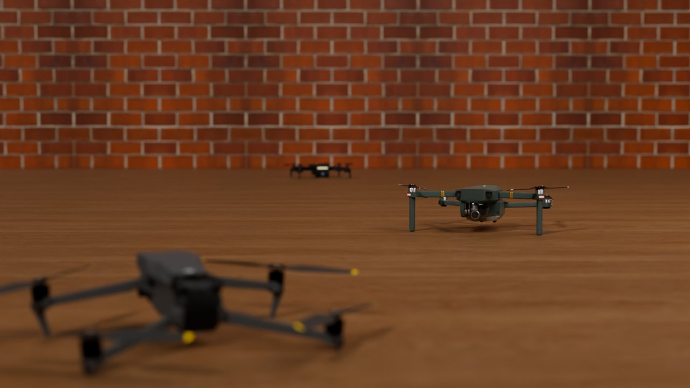

---
# Editable code runs in the reader's browser (Pyodide), not at build time.
engine: markdown
pyodide:
  packages:
    - opencv-python
    - matplotlib
---

# Image Formation {#sec-image-formation}

Every perception system starts with a measurement. For most robots that measurement is an image: a grid of numbers produced when light from the world passes through a lens and lands on a sensor. To understand what an image can and cannot tell a robot, we first need to understand how it is made.

This chapter follows light on that journey, from the scene, through the camera, to the numbers in memory. Most sections have a figure you can play with.

::: {.callout-note appearance="simple"}
**In this chapter.** The pinhole camera and perspective projection · focal length and field of view · lenses, aperture and depth of field · exposure, noise and dynamic range · how sensors record color · shutters and lens artifacts · the image as data.
:::

## Cameras as artificial eyes

Eyes appeared in the animal kingdom more than 500 million years ago, and nature has since tried many designs: simple light-sensitive patches, pinhole eyes, compound eyes and lens eyes like our own. Cameras follow the same physics. A camera gathers light, focuses it, and converts it into a signal.

Cameras have become the most common robot sensor for good reasons:

- **They are cheap and small.** A capable camera module costs a few dollars and weighs a few grams.
- **They are dense.** A single frame contains millions of measurements, far more than a laser rangefinder or an ultrasonic sensor.
- **They are passive.** A camera only receives light, so it uses little power and does not interfere with other robots.
- **They are close to how we see.** Much of the world, from road signs to object colors, is designed for eyes.

The price of this density is that a camera does not measure geometry directly. Depth, size and motion must all be inferred, and that inference starts with a model of how the image was formed.

## The pinhole camera

The simplest camera is a dark box with a tiny hole in one side. Light from each point in the scene passes through the hole in a straight line and lands at exactly one point on the back wall. The result is a sharp, upside-down image.

Let a point in the scene be at height $H$ above the optical axis and distance $Z$ in front of the pinhole, and let the back wall be at distance $f$, the **focal length**. Similar triangles give the height of its image:

$$
h = f \, \frac{H}{Z}.
$$

In three dimensions, a point $(X, Y, Z)$ in the camera's coordinate frame lands at image coordinates

$$
x = f \, \frac{X}{Z}, \qquad y = f \, \frac{Y}{Z}.
$$

This is **perspective projection**, and the division by $Z$ is its most important feature. Distant objects appear smaller, parallel lines meet at vanishing points, and, crucially, depth is lost.

```{=html}
<div class="sim" id="pinhole-sim">
  <svg class="sim__svg" viewBox="0 0 720 300" role="img" aria-label="A pinhole camera: an object on the left, rays through a pinhole, and an inverted image on the right"></svg>
  <div class="sim__controls">
    <label>Object distance Z <input type="range" name="Z" min="2" max="11" step="0.1" value="6"><output></output></label>
    <label>Object height H <input type="range" name="H" min="0.5" max="4.5" step="0.1" value="1.8"><output></output></label>
    <label>Focal length f <input type="range" name="f" min="15" max="110" step="1" value="60"><output></output></label>
    <button type="button" class="btn btn-gold-outline btn-sm" data-action="double">Double size and distance</button>
  </div>
  <p class="sim__readout"></p>
</div>
```

Press **Double size and distance**. The image does not change. A person 1.8 m tall standing 6 m away and a statue 3.6 m tall standing 12 m away produce exactly the same picture. This is the ambiguity from @sec-intro made precise: a single image fixes the ratio $H/Z$, never $H$ and $Z$ separately.

::: {.callout-tip}
## Exercise
A drone's camera has a focal length of 4 mm. A gate 1 m wide appears 0.5 mm wide on the sensor. How far away is the gate? What extra information did you need to answer?
:::

## Focal length and field of view

Focal length sets how much of the world the camera sees. For a sensor of width $w$, the horizontal **field of view** is

$$
\theta = 2 \arctan\!\left(\frac{w}{2f}\right).
$$

A short focal length gives a wide view with small-looking objects. A long focal length narrows the view and magnifies. The scene below was rendered with a 50 mm lens. Increase the focal length to zoom in.

```{=html}
<div class="sim" id="fov-sim">
  <canvas class="sim__canvas"></canvas>
  <div class="sim__controls">
    <label>Focal length <input type="range" name="f" min="50" max="200" step="1" value="50"><output></output></label>
  </div>
  <p class="sim__readout"></p>
</div>
```

Robots choose focal length by task. A drone avoiding obstacles wants a wide view to see threats from the side; a camera reading distant signs wants a narrow one.

## Why cameras need lenses

A real pinhole faces a hard trade-off. A tiny hole gives a sharp image but lets in very little light. A larger hole lets in more light, but each scene point now spreads over a disc on the sensor, and the image blurs. (Make the hole too small and diffraction blurs the image again.)

```{=html}
<div class="sim" id="aperture-sim">
  <canvas class="sim__canvas sim__canvas--chart"></canvas>
  <div class="sim__controls">
    <label>Pinhole diameter <input type="range" name="d" min="0.2" max="3" step="0.1" value="1"><output></output></label>
  </div>
  <p class="sim__readout"></p>
</div>
```

A **lens** escapes this trade-off. It gathers light over a large opening and bends all the rays from one scene point so that they meet again at a single image point. For a thin lens, a point at distance $Z$ comes into focus at distance $z'$ behind the lens, where

$$
\frac{1}{f} = \frac{1}{Z} + \frac{1}{z'}.
$$

The catch is that only one distance can be in perfect focus at a time. Points nearer or farther focus in front of or behind the sensor and appear as small discs, called **circles of confusion**.

## Aperture and depth of field

The opening of the lens is the **aperture**. Its size is given as an **f-number**,

$$
N = \frac{f}{D},
$$

where $D$ is the aperture diameter. Larger f-numbers mean smaller openings: f/1.4 is wide open, f/22 is a pinhole-like squint. Each full stop ($1.4, 2, 2.8, 4, 5.6, \dots$) halves the light.

The aperture also controls **depth of field**, the range of distances that look acceptably sharp. A wide aperture gives a shallow depth of field and soft, blurred backgrounds (photographers call this *bokeh*). A narrow aperture keeps nearly everything sharp.

The scene below was rendered in Blender with a physically based 50 mm camera. Three drones stand 0.6 m, 1.5 m and 4 m away. Choose where to focus, then open and close the aperture.

```{=html}
<div class="sim" id="dof-sim">
  
  <div class="sim__controls">
    <span class="sim__group">Focus on
      <button type="button" class="btn btn-gold-outline btn-sm" data-focus="near">Near drone</button>
      <button type="button" class="btn btn-gold-outline btn-sm is-on" data-focus="mid">Middle drone</button>
      <button type="button" class="btn btn-gold-outline btn-sm" data-focus="far">Far drone</button>
    </span>
    <label>Aperture <input type="range" name="n" min="0" max="4" step="1" value="2"><output></output></label>
  </div>
</div>
```

Depth of field is not only a matter of style. Blur depends on distance, so a camera can use it as a depth cue; later chapters on computational imaging exploit exactly this. For a robot that needs everything sharp, a small aperture helps, but it costs light, which brings us to exposure.

## Exposure

How bright an image looks depends on three settings, often called the **exposure triangle**:

- **Shutter time:** how long the sensor collects light. Longer is brighter, but moving things smear into motion blur.
- **Aperture:** how wide the lens opens. Wider is brighter, but depth of field shrinks.
- **ISO (gain):** how much the sensor's signal is amplified. Higher is brighter, but noise is amplified too.

Each of these doubles or halves the light per stop, so different combinations can give the same overall brightness with very different side effects. Try it below. Here the camera is panning sideways, as on a moving robot, so long shutter times show motion blur.

```{=html}
<div class="sim" id="exposure-sim">
  <canvas class="sim__canvas"></canvas>
  <div class="sim__controls">
    <label>Shutter <input type="range" name="t" min="0" max="7" step="1" value="3"><output></output></label>
    <label>Aperture <input type="range" name="a" min="0" max="7" step="1" value="3"><output></output></label>
    <label>Sensitivity <input type="range" name="iso" min="0" max="7" step="1" value="0"><output></output></label>
  </div>
  <p class="sim__readout"></p>
</div>
```

Robots face these trade-offs constantly. A fast-flying drone needs short shutter times to avoid motion blur, so in dim light it must either open the aperture or raise the gain and accept noise.

### Dynamic range

A sensor can only record brightness within a limited range. Anything brighter than its maximum saturates to pure white; anything darker than its noise floor is lost in black. The ratio between the brightest and darkest values it can record is its **dynamic range**. Scenes such as a tunnel exit on a sunny day exceed the range of most cameras. **High dynamic range (HDR)** imaging captures several exposures and merges them, and some sensors do this within a single frame.

## From light to numbers: the sensor

A digital camera sensor is a grid of millions of light-sensitive sites called **photosites**. Turning light into an image takes several steps:

1. **Capture.** Photons strike each photosite during the exposure.
2. **Conversion.** Each photosite converts the light into electrical charge, roughly in proportion to the number of photons.
3. **Color filtering.** A filter over each photosite lets through only red, green or blue light.
4. **Amplification.** The signal is amplified according to the ISO setting.
5. **Digitization.** An analog-to-digital converter turns the signal into a number, typically 10 to 14 bits.
6. **Processing.** The camera's image signal processor (ISP) fills in missing colors, reduces noise, corrects white balance and compresses the result. Every manufacturer does this differently.

Even with no light at all, a sensor reports small random values. Photons also arrive randomly, so even a perfectly uniform scene produces a slightly grainy image. This **shot noise** grows with the square root of the signal, which is why dim images look noisier.

### How sensors see color

Each photosite measures only one color. The most common arrangement, the **Bayer pattern**, repeats a 2 × 2 tile of one red, two green and one blue filter. Green gets twice as many sites because human vision is most sensitive to green light, which carries most of the detail we perceive.

The camera reconstructs a full-color image by estimating the two missing colors at each pixel from its neighbors, a step called **demosaicing**. Explore a small patch of the render below.

```{=html}
<div class="sim" id="bayer-sim">
  <canvas class="sim__canvas sim__canvas--pixels"></canvas>
  <div class="sim__controls">
    <button type="button" class="btn btn-gold-outline btn-sm" data-mode="gray">Raw sensor values</button>
    <button type="button" class="btn btn-gold-outline btn-sm" data-mode="raw">With the color filters</button>
    <button type="button" class="btn btn-gold-outline btn-sm" data-mode="demosaic">Demosaiced</button>
    <button type="button" class="btn btn-gold-outline btn-sm" data-mode="full">True color</button>
  </div>
</div>
```

Look closely at the **Demosaiced** view near sharp edges. Small colored fringes appear where the estimate guesses wrong. Better demosaicing algorithms, including learned ones, exist precisely to reduce these artifacts.

### Try it in code

The cell below builds a small color image, records it through a simulated Bayer filter, and asks OpenCV to demosaic it. Press **Run Code**. The first run takes a few seconds while OpenCV loads in your browser.

```{pyodide}
import cv2
import numpy as np
import matplotlib.pyplot as plt

# A small color test image (RGB)
img = np.zeros((120, 180, 3), np.uint8)
cv2.rectangle(img, (10, 15), (80, 105), (230, 60, 60), -1)
cv2.circle(img, (130, 60), 40, (60, 190, 90), -1)
cv2.line(img, (0, 118), (179, 2), (70, 90, 230), 3)

# Record it through an RGGB Bayer filter: one value per pixel
mosaic = np.zeros(img.shape[:2], np.uint8)
mosaic[0::2, 0::2] = img[0::2, 0::2, 0]   # red
mosaic[0::2, 1::2] = img[0::2, 1::2, 1]   # green
mosaic[1::2, 0::2] = img[1::2, 0::2, 1]   # green
mosaic[1::2, 1::2] = img[1::2, 1::2, 2]   # blue

# OpenCV names Bayer patterns by a different corner, so RGGB uses BayerBG
restored = cv2.cvtColor(mosaic, cv2.COLOR_BayerBG2RGB)

fig, axes = plt.subplots(1, 3, figsize=(12, 3.2))
for ax, im, title in zip(axes, [img, mosaic, restored],
                         ["Scene", "What the sensor records", "Demosaiced"]):
    ax.imshow(im, cmap="gray" if im.ndim == 2 else None)
    ax.set_title(title)
    ax.axis("off")
plt.show()

print("Largest error after demosaicing:", np.abs(img.astype(int) - restored).max())
```

::: {.callout-tip}
## Exercise
Where in the demosaiced image is the error largest, and why? Try `cv2.COLOR_BayerBG2RGB_EA` (edge-aware demosaicing) and compare the largest error.
:::

## Shutters and motion

Many low-cost sensors do not capture the whole frame at once. A **rolling shutter** reads the rows one after another from top to bottom, so each row sees the scene at a slightly different moment. A **global shutter** exposes every row at the same instant.

For a still scene the difference is invisible. For a spinning propeller, or a camera on a vibrating drone, it is dramatic. On the left is the propeller as it really moves (slowed down 30 times); on the right is what a camera captures. Speed it up, then switch on the global shutter.

```{=html}
<div class="sim" id="rolling-sim">
  <div class="sim__pair">
    <figure><canvas></canvas><figcaption>The propeller</figcaption></figure>
    <figure><canvas></canvas><figcaption>What the camera records</figcaption></figure>
  </div>
  <div class="sim__controls">
    <label>Propeller speed <input type="range" name="rps" min="0" max="60" step="1" value="20"><output></output></label>
    <label>Row readout time <input type="range" name="readout" min="1" max="33" step="1" value="20"><output></output></label>
    <button type="button" class="btn btn-gold-outline btn-sm" data-action="global">Global shutter: off</button>
  </div>
</div>
```

Rolling-shutter distortion bends straight lines and breaks geometric algorithms that assume one moment per image. Robots that move fast, or that rely on precise geometry, often pay more for global-shutter cameras.

## Lens imperfections

Real lenses are not ideal. Two imperfections matter often:

- **Geometric distortion.** Straight lines bow outward (barrel distortion, common in wide-angle lenses) or inward (pincushion). It can be measured and corrected through calibration, which a later chapter covers.
- **Chromatic aberration.** Glass bends different wavelengths by different amounts, so a lens cannot focus red, green and blue at exactly the same place. Edges, especially near the image corners, show colored fringes.

```{=html}
<div class="sim" id="chroma-sim">
  <canvas class="sim__canvas"></canvas>
  <div class="sim__controls">
    <label>Aberration strength <input type="range" name="k" min="0" max="2" step="0.1" value="0.8"><output></output></label>
  </div>
</div>
```

## The image as data

After all of this, what reaches the robot's software is an array of numbers. A grayscale image of height $H$ and width $W$ is a matrix $I \in \{0, \dots, 255\}^{H \times W}$. A color image stacks three such matrices, one per channel. Turn on your camera to see your own image split into its red, green and blue channels. Hold up something brightly colored and watch which channel lights up.

```{=html}
<div class="sim" id="channels-demo">
  <video playsinline muted hidden></video>
  <div class="sim__trio">
    <figure><canvas></canvas><figcaption>Red</figcaption></figure>
    <figure><canvas></canvas><figcaption>Green</figcaption></figure>
    <figure><canvas></canvas><figcaption>Blue</figcaption></figure>
  </div>
  <div class="sim__controls">
    <button type="button" class="btn btn-primary btn-sm">Start camera</button>
  </div>
  <p class="sim__readout">Video is processed in your browser and never uploaded.</p>
</div>
```

The cell below builds an image from scratch and shows its channels. Change the shapes or colors and run it again.

```{pyodide}
import cv2
import numpy as np
import matplotlib.pyplot as plt

img = np.zeros((200, 300, 3), np.uint8)               # height, width, channels
cv2.rectangle(img, (20, 30), (130, 170), (255, 60, 60), -1)
cv2.circle(img, (210, 100), 60, (60, 200, 90), -1)

fig, axes = plt.subplots(1, 4, figsize=(12, 3))
axes[0].imshow(img)
axes[0].set_title("Image")
for ax, channel, name in zip(axes[1:], cv2.split(img), ["Red", "Green", "Blue"]):
    ax.imshow(channel, cmap="gray", vmin=0, vmax=255)
    ax.set_title(name)
for ax in axes:
    ax.axis("off")
plt.show()

print("Shape:", img.shape, " Type:", img.dtype)
```

Red, green and blue are not the only way to describe color. Other **color spaces** separate brightness from color, which is often more useful for perception: HSV describes hue, saturation and value, and Lab is designed so that distances match perceived differences. OpenCV converts between them with `cv2.cvtColor`.

::: {.callout-tip}
## Exercise
Convert the image above to grayscale with `cv2.cvtColor(img, cv2.COLOR_RGB2GRAY)`. Which shape looks brighter, and why? Then convert it to HSV and display the hue channel.
:::

## Summary

- A camera projects the 3D world onto a 2D sensor. Perspective projection, $x = fX/Z$, divides by depth, so a single image cannot separate size from distance.
- Focal length sets the field of view. Lenses gather light without the blur of a large pinhole, but focus only one distance perfectly.
- Aperture, shutter time and gain together set exposure, each with a side effect: shallow depth of field, motion blur or noise.
- Sensors measure one color per photosite through a Bayer filter and reconstruct full color by demosaicing.
- Rolling shutters, lens distortion and chromatic aberration all bend the simple pinhole model, and robots must account for them.

```{=html}
<script src="../demos/image-formation.js"></script>
```
