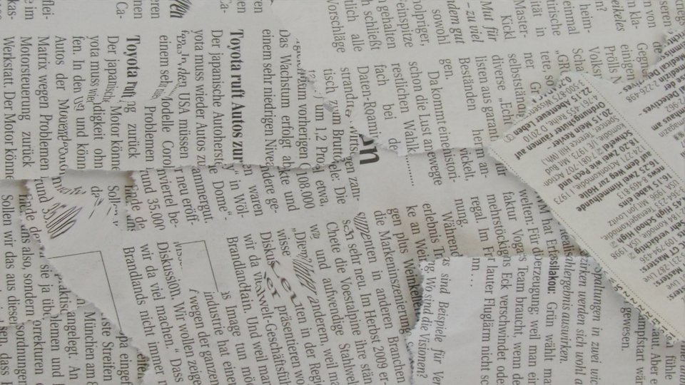
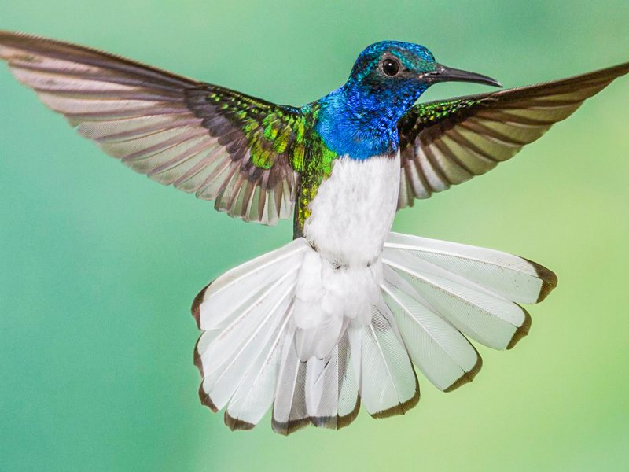
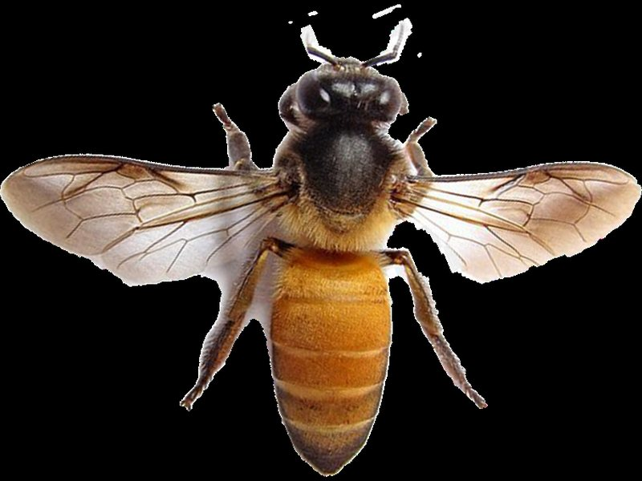

# Introduction {#sec-intro}

A robot that cannot perceive cannot act with purpose. Before it can grasp an object, cross a room or fly through a gap, it has to work out what is around it, where things are and how they are moving. This book is about how robots do that: how they turn light and other signals into an understanding of the world that is good enough to act on.

This chapter sets the stage. It answers four questions: what perception is, why it is hard, who it matters to, and why the subject is changing so quickly in the current era of artificial intelligence.

## What is perception?

Philosophers have debated the word for centuries. For engineers, a working definition is enough:

::: {.callout-note appearance="simple"}
**Perception** is the organization, identification and interpretation of sensory information in order to represent and understand the environment.
:::

Three parts of this definition matter for robots:

- **Sensory information.** The raw input is a measurement, not a description. A camera records how much light reached each pixel. It does not record that there is a chair in the room.
- **Representation.** Perception produces something the rest of the system can use: a depth map, a set of detected objects, a 3D model, an estimate of the robot's own motion.
- **Understanding for a purpose.** A robot does not perceive for its own sake. It perceives so that it can decide and act.

That last point separates *robot perception* from the wider field of *computer vision*. Computer vision asks what an image contains. Robot perception asks what the robot needs to know, right now, to do its job safely. The two share most of their tools, and this book draws on both.

::: {#fig-loop}
```{=html}
<svg class="loop-figure" viewBox="0 0 640 250" role="img" aria-label="The perception and action loop: the world is measured by sensors, perception builds a representation, the robot decides and acts, and its motion changes the world it senses next.">
  <defs>
    <marker id="loop-arrow" viewBox="0 0 10 10" refX="9" refY="5" markerWidth="7" markerHeight="7" orient="auto-start-reverse">
      <path d="M0,0 L10,5 L0,10 z" fill="#cfb97d"/>
    </marker>
  </defs>
  <g fill="none" stroke="#cfb97d" stroke-width="2" marker-end="url(#loop-arrow)">
    <path d="M150 55 H232"/>
    <path d="M370 55 H452"/>
    <path d="M535 80 V168"/>
    <path d="M452 195 H370"/>
    <path d="M232 195 H150"/>
    <path d="M85 168 V80"/>
  </g>
  <g class="loop-figure__box">
    <rect x="20" y="30" width="130" height="50" rx="12"/>
    <rect x="235" y="30" width="135" height="50" rx="12"/>
    <rect x="455" y="30" width="165" height="50" rx="12" class="loop-figure__accent"/>
    <rect x="455" y="170" width="165" height="50" rx="12"/>
    <rect x="235" y="170" width="135" height="50" rx="12"/>
    <rect x="20" y="170" width="130" height="50" rx="12"/>
  </g>
  <g class="loop-figure__label" text-anchor="middle">
    <text x="85" y="60">World</text>
    <text x="302" y="60">Sensors</text>
    <text x="537" y="60">Perception</text>
    <text x="537" y="200">Decision</text>
    <text x="302" y="200">Actuation</text>
    <text x="85" y="200">Motion</text>
  </g>
  <g class="loop-figure__note" text-anchor="middle">
    <text x="191" y="45">light</text>
    <text x="411" y="45">signals</text>
    <text x="580" y="128">representation</text>
    <text x="411" y="186">commands</text>
    <text x="191" y="186">forces</text>
    <text x="60" y="128">changes</text>
  </g>
</svg>
```

Perception closes the loop between sensing and acting. What the robot does changes what it senses next.
:::

## Why is perception hard?

People see effortlessly, so it is easy to underestimate the problem. A five-year-old recognizes a cup from any angle, in any light, half hidden behind a book. For decades this was far beyond any computer, even as computers became superhuman at chess and arithmetic. Hans Moravec observed this pattern in the 1980s: the abilities that feel easiest to us are often the hardest to build.

Several reasons stand out.

**A camera loses information.** An image is a two-dimensional projection of a three-dimensional world. Depth is discarded at the moment of capture, and many different scenes produce exactly the same image. A small object nearby and a large object far away can look identical. Recovering the world from images is therefore an *inverse problem* without a unique answer, and every perception system relies on assumptions, priors or extra measurements to resolve the ambiguity.


::: {.callout-tip appearance="simple"}
## Try it: find the object
There is an object in the picture below. Can you find it? Then press **Play motion** and watch it again.
:::

```{=html}
<figure class="camo" id="camo">
  <div class="camo__stage">
    
    <video class="camo__video" src="media/intro/camouflage.mp4" muted loop playsinline preload="none" hidden></video>
    
  </div>
  <div class="camo__controls">
    <button type="button" class="btn btn-primary btn-sm" data-camo="play">Play motion</button>
    <button type="button" class="btn btn-gold-outline btn-sm" data-camo="reveal">Reveal the object</button>
    <button type="button" class="btn btn-gold-outline btn-sm" data-camo="reset">Reset</button>
  </div>
  <figcaption>A camouflaged object is almost invisible in a single image. The moment it moves, it stands out. Motion carries information that one picture cannot.</figcaption>
</figure>
<script>
(() => {
  const fig = document.getElementById("camo");
  const still = fig.querySelector(".camo__still");
  const video = fig.querySelector(".camo__video");
  const mask = fig.querySelector(".camo__mask");
  const reveal = fig.querySelector('[data-camo="reveal"]');
  // The mask matches the first frame only, so revealing works on the still image.
  fig.addEventListener("click", (event) => {
    const action = event.target.closest("[data-camo]")?.dataset.camo;
    if (action === "play") { mask.hidden = true; reveal.disabled = true; still.hidden = true; video.hidden = false; video.play(); }
    if (action === "reveal" && !still.hidden) { mask.hidden = !mask.hidden; }
    if (action === "reset") { video.pause(); video.currentTime = 0; video.hidden = true; still.hidden = false; mask.hidden = true; reveal.disabled = false; }
  });
})();
</script>
```
**The same thing never looks the same twice.** Lighting, viewpoint, occlusion, motion blur, sensor noise, reflections and weather all change the measurement while the underlying object stays the same. A useful perception system must be invariant to the changes that do not matter and sensitive to the ones that do.

**There is too much data and too little time.** Cameras produce millions of measurements per frame, many times per second. Biological vision copes by being highly selective: the eye samples finely only at the center of gaze, and the brain processes only a small fraction of what reaches the retina in detail. Robots face the same constraint, sharpened by limits on power, weight and onboard computation.

**Mistakes have consequences.** An error in a photo-tagging application is an inconvenience. An error in a robot's perception can mean a collision. Robot perception must work in real time, report how confident it is, and fail safely.

## Lessons from nature

Nature offers proof that capable perception does not require enormous resources. A honeybee's brain is smaller than a sesame seed and contains about a million neurons, yet bees navigate kilometers to food sources, avoid obstacles in cluttered environments and return home reliably.

Birds and insects solve the same problem, flying through a narrow gap, in very different ways. Many birds have sharp, fast eyes and enough neural processing to judge a gap at a glance and fly straight through at speed. An insect has neither. Its compound eyes have low resolution, and its brain is tiny. Instead it *moves to see*: it sweeps from side to side in front of the gap, uses the resulting image motion to tell near from far, and then steers toward the opening.


```{=html}
<div class="versus">
  <figure class="versus__card">
    <div class="versus__media">
      
      <span class="versus__tag">Bird</span>
    </div>
    <figcaption>
      <strong>See, then fly</strong>
      <span class="versus__facts">
        <span><b>Eyes</b> Sharp and fast</span>
        <span><b>Brain</b> Large</span>
        <span><b>Strategy</b> Judge the gap at a glance</span>
      </span>
    </figcaption>
  </figure>
  <span class="versus__vs" aria-hidden="true">vs</span>
  <figure class="versus__card">
    <div class="versus__media">
      
      <span class="versus__tag">Insect</span>
    </div>
    <figcaption>
      <strong>Move, then see</strong>
      <span class="versus__facts">
        <span><b>Eyes</b> Low resolution</span>
        <span><b>Brain</b> About a million neurons</span>
        <span><b>Strategy</b> Sweep in front, then steer</span>
      </span>
    </figcaption>
  </figure>
  <p class="versus__credit">Honeybee photo: <a href="https://commons.wikimedia.org/wiki/File:Bogdan_Suditu_-_Bee_(by).jpg">Bogdan Suditu</a>, <a href="https://creativecommons.org/licenses/by/2.0/">CC BY 2.0</a>, cropped.</p>
</div>
```

Robots can borrow the insect's trick. In GapFlyt, a small quadrotor finds a gap of unknown shape and size by moving in front of it and watching how the scene slides past, then flies through it using only its onboard camera and computer.

```{=html}
<figure class="clip">
  <video src="media/intro/gapflyt.mp4" poster="media/intro/gapflyt.jpg" autoplay muted loop playsinline></video>
  <figcaption>GapFlyt: active perception lets a quadrotor fly through an unknown gap (shown at quarter speed).</figcaption>
</figure>
```
The insect's strategy carries two ideas that run through this book:

- **Perception can be active.** A robot can choose how to move, where to look and what to sense in order to make perception easier. This idea, formalized as *active vision* and *active perception* in the late 1980s, turns some hard problems into much simpler ones.
- **Perception can be minimal.** A robot rarely needs a complete model of the world. It needs the information that matters for its task. Designing perception around the task, rather than around a general-purpose reconstruction, is what makes small, low-power robots possible.


```{=html}
<figure class="clip-grid">
  <video src="media/intro/drone-view.mp4" poster="media/intro/drone-view.jpg" autoplay muted loop playsinline></video>
  <video src="media/intro/drone-flow.mp4" poster="media/intro/drone-flow.jpg" autoplay muted loop playsinline></video>
  <video src="media/intro/forest-flight.mp4" poster="media/intro/forest-flight.jpg" autoplay muted loop playsinline></video>
  <video src="media/intro/tabletop.mp4" poster="media/intro/tabletop.jpg" autoplay muted loop playsinline></video>
  <video src="media/intro/scale.mp4" poster="media/intro/scale.jpg" autoplay muted loop playsinline></video>
  <video src="media/intro/camera-hw.mp4" poster="media/intro/camera-hw.jpg" autoplay muted loop playsinline></video>
  <figcaption>Minimal perception in practice: tiny drones that fly indoors and through forests, custom sensors and lenses, and perception that runs on small, low-power hardware. Examples from the author's research.</figcaption>
</figure>
```
## A brief history

Computer vision is younger than most engineering disciplines, and it has been wonderfully overconfident from the start. Here is the story in ten stops.

```{=html}
<ol class="timeline">
  <li class="timeline__item">
    <svg class="timeline__icon" viewBox="0 0 64 64" aria-hidden="true"><path d="M14 24 L30 16 L46 24 L30 32 Z"/><path d="M14 24 V42 L30 50 V32"/><path d="M46 24 V42 L30 50"/><path d="M42 40 L50 36 L58 40 L50 44 Z" class="f"/><path d="M42 40 V50 L50 54 V44 M58 40 V50 L50 54"/></svg>
    <span class="timeline__year">1963</span>
    <strong class="timeline__title">The blocks world</strong>
    <span class="timeline__text">Larry Roberts gets a computer to recover the 3D shape of toy blocks from a photograph. The world is simple, the lighting is perfect, and the field is born.</span>
  </li>
  <li class="timeline__item">
    <svg class="timeline__icon" viewBox="0 0 64 64" aria-hidden="true"><circle cx="20" cy="18" r="6"/><path d="M20 6v3M20 27v3M8 18h3M29 18h3M11.5 9.5l2 2M26.5 24.5l2 2M11.5 26.5l2-2M26.5 11.5l2-2"/><rect x="22" y="32" width="32" height="20" rx="4" class="f"/><circle cx="38" cy="42" r="6"/><path d="M28 32 l3 -5 h8 l3 5"/></svg>
    <span class="timeline__year">1966</span>
    <strong class="timeline__title">A summer project</strong>
    <span class="timeline__text">MIT's Summer Vision Project sets out to connect a camera to a computer and have it describe what it sees, in one summer. Sixty years later, the summer is still going.</span>
  </li>
  <li class="timeline__item">
    <svg class="timeline__icon" viewBox="0 0 64 64" aria-hidden="true"><path d="M32 18 C24 13 14 13 8 16 V50 C14 47 24 47 32 52 C40 47 50 47 56 50 V16 C50 13 40 13 32 18 Z"/><path d="M32 18 V52"/><rect x="38" y="22" width="5" height="5" class="f"/><rect x="45" y="22" width="5" height="5"/><rect x="38" y="29" width="5" height="5"/><rect x="45" y="29" width="5" height="5" class="f"/><path d="M13 24h13M13 30h13M13 36h10"/></svg>
    <span class="timeline__year">1969</span>
    <strong class="timeline__title">The first textbook</strong>
    <span class="timeline__text">Azriel Rosenfeld publishes <em>Picture Processing by Computer</em> and later founds the field's first journal. Every image library you will use, OpenCV included, carries his ideas.</span>
  </li>
  <li class="timeline__item">
    <svg class="timeline__icon" viewBox="0 0 64 64" aria-hidden="true"><path d="M10 44 L32 54 L54 44 L32 34 Z"/><path d="M10 34 L32 44 L54 34 L32 24 Z" class="f"/><path d="M10 24 L32 34 L54 24 L32 14 Z"/></svg>
    <span class="timeline__year">1982</span>
    <strong class="timeline__title">Vision as computation</strong>
    <span class="timeline__text">David Marr's <em>Vision</em> argues that seeing is a sequence of representations, from pixels to edges to surfaces to objects. The framework still shapes how we teach the subject.</span>
  </li>
  <li class="timeline__item">
    <svg class="timeline__icon" viewBox="0 0 64 64" aria-hidden="true"><path d="M8 32 C16 20 26 16 32 16 C38 16 48 20 56 32 C48 44 38 48 32 48 C26 48 16 44 8 32 Z"/><circle cx="32" cy="32" r="7" class="f"/><path d="M6 12 h12 M14 8 l4 4 l-4 4 M58 52 h-12 M50 48 l-4 4 l4 4"/></svg>
    <span class="timeline__year">1988</span>
    <strong class="timeline__title">Move to see</strong>
    <span class="timeline__text">Active vision and active perception show that a camera that moves with purpose can solve problems a still camera cannot. Insects knew this all along.</span>
  </li>
  <li class="timeline__item">
    <svg class="timeline__icon" viewBox="0 0 64 64" aria-hidden="true"><rect x="6" y="14" width="22" height="30" rx="3"/><rect x="36" y="20" width="22" height="30" rx="3" transform="rotate(8 47 35)"/><circle cx="13" cy="22" r="2" class="f"/><circle cx="21" cy="34" r="2" class="f"/><circle cx="15" cy="38" r="2" class="f"/><circle cx="43" cy="27" r="2" class="f"/><circle cx="50" cy="40" r="2" class="f"/><circle cx="43" cy="44" r="2" class="f"/><path d="M15 22 L43 27 M23 34 L50 40 M17 38 L43 44" stroke-dasharray="2 3"/></svg>
    <span class="timeline__year">1999</span>
    <strong class="timeline__title">Features that travel</strong>
    <span class="timeline__text">SIFT finds the same points in different photos despite changes in scale and rotation. A decade later, researchers rebuild Rome in 3D from tourists' photos in about a day.</span>
  </li>
  <li class="timeline__item">
    <svg class="timeline__icon" viewBox="0 0 64 64" aria-hidden="true"><circle cx="12" cy="20" r="4"/><circle cx="12" cy="44" r="4"/><circle cx="32" cy="14" r="4" class="f"/><circle cx="32" cy="32" r="4"/><circle cx="32" cy="50" r="4" class="f"/><circle cx="52" cy="26" r="4"/><circle cx="52" cy="40" r="4" class="f"/><path d="M16 20 L28 14 M16 20 L28 32 M16 20 L28 50 M16 44 L28 14 M16 44 L28 32 M16 44 L28 50 M36 14 L48 26 M36 14 L48 40 M36 32 L48 26 M36 32 L48 40 M36 50 L48 26 M36 50 L48 40"/></svg>
    <span class="timeline__year">2012</span>
    <strong class="timeline__title">The deep learning moment</strong>
    <span class="timeline__text">A convolutional network trained on two gaming graphics cards wins the ImageNet challenge by a wide margin. Learned features start replacing hand-designed ones almost overnight.</span>
  </li>
  <li class="timeline__item">
    <svg class="timeline__icon" viewBox="0 0 64 64" aria-hidden="true"><path d="M26 26 L38 20 L50 26 L38 32 Z" class="f"/><path d="M26 26 V38 L38 44 V32 M50 26 V38 L38 44"/><rect x="4" y="8" width="10" height="8" rx="2"/><rect x="4" y="46" width="10" height="8" rx="2"/><rect x="50" y="52" width="10" height="8" rx="2" transform="rotate(-20 55 56)"/><path d="M14 12 L30 26 M14 50 L30 38 M50 54 L44 40" stroke-dasharray="2 3"/></svg>
    <span class="timeline__year">2020</span>
    <strong class="timeline__title">Photos become worlds</strong>
    <span class="timeline__text">Neural radiance fields turn a few dozen photos into a 3D scene you can fly through from new viewpoints. Rendering and vision start to merge.</span>
  </li>
  <li class="timeline__item">
    <svg class="timeline__icon" viewBox="0 0 64 64" aria-hidden="true"><path d="M16 46 C10 38 14 24 26 22 C34 14 50 18 50 30 C58 36 52 50 40 48 C32 54 20 52 16 46 Z" class="f"/><path d="M16 46 C10 38 14 24 26 22 C34 14 50 18 50 30 C58 36 52 50 40 48 C32 54 20 52 16 46 Z" stroke-dasharray="3 3" transform="translate(-3 -3)"/><path d="M50 8 v8 M46 12 h8 M58 18 v4 M56 20 h4"/></svg>
    <span class="timeline__year">2023</span>
    <strong class="timeline__title">See anything, in real time</strong>
    <span class="timeline__text">Foundation models segment objects they were never trained on, and Gaussian splatting renders reconstructed scenes in real time. The tools reach everyday users.</span>
  </li>
  <li class="timeline__item timeline__item--now">
    <svg class="timeline__icon" viewBox="0 0 64 64" aria-hidden="true"><rect x="26" y="28" width="12" height="9" rx="3" class="f"/><path d="M26 30 L14 22 M38 30 L50 22 M26 35 L14 43 M38 35 L50 43"/><ellipse cx="12" cy="20" rx="9" ry="3"/><ellipse cx="52" cy="20" rx="9" ry="3"/><ellipse cx="12" cy="45" rx="9" ry="3"/><ellipse cx="52" cy="45" rx="9" ry="3"/><circle cx="32" cy="41" r="2"/></svg>
    <span class="timeline__year">Now</span>
    <strong class="timeline__title">Your turn</strong>
    <span class="timeline__text">Robots that perceive with a few watts, explain what they see and know when they are unsure. The next stop on this line is yours to write.</span>
  </li>
</ol>
```

Each era kept what worked from the last. Geometry did not disappear when deep learning arrived; it became a source of structure, supervision and guarantees for learned systems.

## Perception in the era of AI

Perception is changing faster now than at any point in its history. Models trained on very large datasets can segment almost any object, estimate depth from a single image, describe a scene in language and answer questions about it. Vision-language models allow robots to take instructions in plain words. These advances have moved tasks that were research problems a few years ago into everyday tools.

They have also sharpened the questions that matter for robots:

- **Can it run on the robot?** The largest models need data-center hardware. Many robots, from drones to wearable devices, must perceive with a few watts and no network connection.
- **Can we trust it?** A model that is right most of the time can still fail in ways that are hard to predict. Robots need calibrated confidence, physical consistency and a clear account of what the system does not know.
- **Does it respect geometry and physics?** Cameras, lenses and motion obey precise laws. Methods that build these laws in tend to need less data, generalize better and fail more gracefully.

The approach of this book follows from these questions. Learning-based methods are covered in depth, but always alongside the geometry and physics that explain *why* they work and *when* they fail. A practitioner who understands both can choose the right tool, combine them, and recognize when a result is too good to be true.

## Who this book is for

This book is written for advanced undergraduate and graduate students in robotics, mechanical, electrical and aerospace engineering and computer science, and for engineers who want a solid foundation in robot perception.

No prior knowledge of computer vision is assumed. You will get the most from it with:

- **Linear algebra:** vectors, matrices, eigenvalues and least squares.
- **Calculus and probability:** derivatives, gradients, distributions and expectation.
- **Programming:** working knowledge of Python. Familiarity with NumPy helps.

## How to use this book

Each chapter combines explanation, mathematics and practice:

- **Live demos** run on your own webcam in the browser. Video is processed on your device and never uploaded.
- **Editable code cells** contain real Python and OpenCV. Change the code and press **Run Code** to see the result, with nothing to install.
- **Exercises** at the end of sections test understanding and suggest experiments.

The chapters build on each other, starting from how images are formed and represented, moving through features and geometry, and arriving at 3D reconstruction, motion and learned models. Readers who already know the basics can use the sidebar to go straight to the topic they need.

::: {.callout-tip}
## Before you continue
Look around the room you are in and pick one object. List everything you would need to know about it to pick it up with a robot arm: where it is, how big it is, what it is made of, how it might move. Then ask which of those a single photograph could tell you, and which it could not. Keep the list. Much of this book is about filling in the gaps.
:::