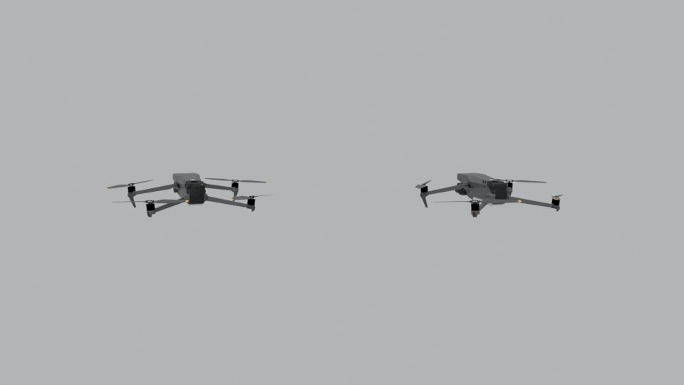

---
# Editable code runs in the reader's browser (Pyodide), not at build time.
engine: markdown
pyodide:
  packages:
    - numpy
    - matplotlib
---

# Single-View Geometry {#sec-single-view}

```{=html}
<link rel="stylesheet" href="../assets/single-view.css">
```

Hand someone a single photograph and ask how tall the door is, how far away the car is, or whether the floor is level. Surprisingly often, they can answer. This chapter asks how. What can be measured from one image, what cannot, and which assumptions turn an ambiguous picture into numbers a robot can use?

The tools are those of projective geometry, which we met in @sec-transformations, applied to the camera model of @sec-camera-models. Parallel lines in the world meet at **vanishing points** in the image; the **horizon** encodes how the camera is oriented; and a single known length can be transferred across the scene to measure others. At the end of the chapter we look at what a single view fundamentally cannot recover, and at how learned priors fill the gap.

::: {.callout-note appearance="simple"}
**In this chapter.** Points and lines in homogeneous coordinates · vanishing points and the horizon · calibration from vanishing points · measuring heights from one image · the cross-ratio · single-view metrology · ambiguity, scale and monocular depth.
:::

## What can one image tell us?

Recall from @sec-image-formation that perspective projection divides by depth, $x = fX/Z$. Every pixel therefore corresponds to a whole ray of possible scene points, and a single image cannot, on its own, tell how far along that ray the surface lies. That sounds hopeless, yet a photograph of a building, a corridor or a road carries a great deal of structure:

- Many man-made scenes are full of **parallel lines** and **right angles**.
- Objects usually **stand on a ground plane**, and walls are **vertical**.
- We often know the size of **something** in view: a door, a person, a floor tile, a marker.

Each of these is an assumption about the world. Single-view geometry is the art of stating such assumptions precisely and turning them into measurements. When the assumptions hold, the results can be remarkably accurate. When they fail, the same equations confidently give wrong answers, which is worth remembering whenever a robot relies on one camera.

## Points and lines on the image plane

In @sec-transformations we represented an image point $(x, y)$ in homogeneous coordinates as $\mathbf{x} = (x, y, 1)^\top$, defined up to scale. Lines have an equally neat representation. The line $ax + by + c = 0$ is the vector $\mathbf{l} = (a, b, c)^\top$, also defined up to scale, and a point lies on a line exactly when

$$
\mathbf{l}^\top \mathbf{x} = 0.
$$

Two facts follow from this symmetry between points and lines, and they are the workhorses of this chapter:

$$
\mathbf{l} = \mathbf{p} \times \mathbf{q} \quad \text{(the line through two points)}, \qquad
\mathbf{x} = \mathbf{l} \times \mathbf{m} \quad \text{(the point where two lines meet)}.
$$

No special cases, no division by zero. If the two lines are parallel, the cross product still returns a perfectly good vector, but its third coordinate is zero: $\mathbf{x} = (x, y, 0)^\top$. That is a **point at infinity**, the point where parallel lines meet, and $(x, y)$ is their common direction.

Drag the four handles below. The gold line passes through $\mathbf{a}$ and $\mathbf{b}$, the teal line through $\mathbf{c}$ and $\mathbf{d}$. Then press **Make parallel** and watch the third coordinate of the intersection drop to zero.

```{=html}
<div class="sim" id="line-lab">
  <svg class="sv-svg" viewBox="0 0 640 360" role="img" aria-label="Two lines defined by draggable points and their intersection"></svg>
  <div class="sim__controls">
    <button type="button" class="btn btn-gold-outline btn-sm" data-action="parallel">Make parallel</button>
  </div>
  <p class="sim__readout"></p>
</div>
```

## Vanishing points

Rails, corridor walls and the edges of a building are parallel in the world, yet in a photograph they converge. Where they meet is a **vanishing point**, and it depends only on the lines' common direction, not on where the lines are.

To see why, take a 3D line through a point $\mathbf{A}$ with direction $\mathbf{d}$, so its points are $\mathbf{A} + t\,\mathbf{d}$. With the camera model of @sec-camera-models, $\mathbf{x} \sim K\,(R\,\mathbf{X} + \mathbf{t})$, the image of a point on the line is

$$
\mathbf{x}(t) \sim K\,(R\mathbf{A} + \mathbf{t}) + t\,K R\,\mathbf{d}.
$$

As $t \to \infty$ the second term dominates, so every line with direction $\mathbf{d}$ heads to the same image point

$$
\mathbf{v} \sim K R\,\mathbf{d}.
$$

Two consequences matter in practice:

- **Each direction has one vanishing point.** All lines parallel to the floor's long edge share one vanishing point; all lines parallel to its short edge share another.
- **Each plane has a vanishing line.** The vanishing points of every direction within a plane lie on a single line. For the ground plane this line is the **horizon**. Every point on it is at exactly the camera's height above the ground.

The scene below was rendered in Blender: a level camera, 1.5 m above the floor, looks into the corner of a room. The gold segments follow edges parallel to one wall, the teal segments edges parallel to the other, and the rose segments vertical edges. Drag any endpoint. The extended lines meet at the vanishing points, and the dashed line through them is the horizon.

```{=html}
<div class="sim" id="vp-lab">
  <svg class="sv-svg" role="img" aria-label="A rendered room corner with draggable line segments and the vanishing points they define"></svg>
  <div class="sim__controls">
    <button type="button" class="btn btn-gold-outline btn-sm" data-action="jitter">Add small errors</button>
    <button type="button" class="btn btn-gold-outline btn-sm" data-action="truth">Show true values</button>
    <button type="button" class="btn btn-gold-outline btn-sm" data-action="reset">Reset</button>
  </div>
  <p class="sim__readout"></p>
</div>
```

Because the camera is level, the vertical edges stay parallel in the image and their vanishing point is at infinity. Tilt a real camera up at a tall building and the verticals converge too, toward a third vanishing point above or below the frame. Press **Add small errors** a few times: a few pixels of error in the segments moves the vanishing points noticeably, and more so the more nearly parallel the image lines are. In practice, robust estimates use many segments and RANSAC from @sec-transformations.

## Calibrating a camera from vanishing points

Vanishing points carry information about the camera itself. If two directions $\mathbf{d}_1$ and $\mathbf{d}_2$ are perpendicular, such as the two walls of a room, then $\mathbf{d}_1^\top \mathbf{d}_2 = 0$. Since $\mathbf{d}_i \sim R^\top K^{-1}\mathbf{v}_i$ and $R$ is a rotation,

$$
\mathbf{v}_1^\top \, K^{-\top} K^{-1} \, \mathbf{v}_2 = 0.
$$

For a camera with square pixels, no skew and principal point $\mathbf{c} = (c_x, c_y)$ at the image center, $K$ has one unknown, the focal length $f$ in pixels, and the constraint becomes

$$
(\mathbf{v}_1 - \mathbf{c}) \cdot (\mathbf{v}_2 - \mathbf{c}) + f^2 = 0
\qquad\Longrightarrow\qquad
f = \sqrt{-(\mathbf{v}_1 - \mathbf{c}) \cdot (\mathbf{v}_2 - \mathbf{c})}.
$$

The figure above applies this formula live: with the segments in place, it recovers the 640 pixel focal length of the 18 mm lens used for the render. With three mutually perpendicular directions, the principal point need not be assumed either: it is the orthocenter of the triangle formed by the three vanishing points. This is how photographs of buildings can be calibrated long after they were taken, with no checkerboard in sight.

::: {.callout-tip}
## Exercise
In the figure, drag one gold segment so its vanishing point moves toward the image center. What happens to the estimated focal length, and why does the formula stop working when $(\mathbf{v}_1 - \mathbf{c}) \cdot (\mathbf{v}_2 - \mathbf{c})$ becomes positive?
:::

## Measuring heights from one image

A classic puzzle asks for the height of a tree. On a sunny day, measure its shadow and the shadow of a stick of known height: by similar triangles, the ratio of heights equals the ratio of shadows. A single photograph allows a similar trick, with the horizon taking the role of the sun.

Assume the camera is level, objects stand vertically on a flat ground plane, and the camera is at height $H_c$. An object of height $H$ at depth $Z$ has its base a distance $f H_c / Z$ below the horizon and its top a distance $f H / Z$ above its base. Dividing removes both the unknown depth and the focal length:

$$
\frac{H}{H_c} = \frac{y_{\text{base}} - y_{\text{top}}}{y_{\text{base}} - y_{\text{horizon}}}.
$$

Anything exactly at the camera's height touches the horizon, anything taller pokes above it, and the ratio tells how much taller. If one object of known height is visible, the formula first gives the camera height and then the height of everything else standing on the same floor.

In the figure, the gold handles mark a vertical edge of the gold box, which is 0.60 m tall. The white handles mark the object you choose to measure. Adjust the handles to the base and top of each object, and drag the **horizon** label up or down to see how sensitive the estimate is to where you believe the horizon lies.

```{=html}
<div class="sim" id="height-lab">
  <svg class="sv-svg" role="img" aria-label="A rendered room with draggable markers for measuring object heights"></svg>
  <div class="sim__controls">
    <span class="sim__group">Measure
      <button type="button" class="btn btn-gold-outline btn-sm is-on" data-target="column">Column</button>
      <button type="button" class="btn btn-gold-outline btn-sm" data-target="tall box">Teal box</button>
      <button type="button" class="btn btn-gold-outline btn-sm" data-target="crate">Grey crate</button>
    </span>
  </div>
  <p class="sim__readout"></p>
</div>
```

The result is only as good as the assumptions. If the target is not standing on the same floor, if it leans, or if the camera is tilted, the simple formula is wrong. A tilted camera makes vertical lines converge to a finite vanishing point $\mathbf{v}_z$, and the measurement must use the cross-ratio of the next section along each vertical line instead.

## The cross-ratio

Perspective projection does not preserve lengths, and it does not preserve ratios of lengths either: equally spaced fence posts are not equally spaced in a photograph. One quantity does survive. For four points $A, B, C, D$ on a line, the **cross-ratio**

$$
\operatorname{CR}(A, B, C, D) = \frac{\overline{AC}\;\overline{BD}}{\overline{BC}\;\overline{AD}}
$$

is the same in the world and in any perspective image of the line. It is the fundamental invariant of projective geometry, just as length is for rigid motion.

Drag the four gold points along the world line, move the camera center (white), or tilt the image line. Simple ratios change; the cross-ratio does not.

```{=html}
<div class="sim" id="cr-lab">
  <svg class="sv-svg" viewBox="0 0 640 360" role="img" aria-label="Four collinear points projected through a camera center onto an image line"></svg>
  <div class="sim__controls">
    <label>Image line tilt <input type="range" name="tilt" min="-35" max="35" step="1" value="12"><output></output></label>
  </div>
  <p class="sim__readout"></p>
</div>
```

The cross-ratio is what makes general single-view measurement work. On the image of a vertical line, take the base $b$, the top $t$, the point $h$ where the line crosses the horizon, and the vertical vanishing point $\mathbf{v}_z$. Their cross-ratio equals that of the corresponding world points: the ground, the object's top, a point at camera height and the point at infinity. Since the world positions are $0$, $H$, $H_c$ and $\infty$, the cross-ratio reduces to a ratio of heights, for any camera tilt.

## Single-view metrology

Combining these ideas gives **single-view metrology**, developed systematically by Criminisi, Reid and Zisserman around the year 2000. From one image and a few known lengths, it measures:

- **Heights** of objects relative to a reference plane, using the horizon and vertical vanishing point.
- **Distances and areas on a plane**, by computing the homography that maps the plane to a fronto-parallel view, exactly as in the rectification figure of @sec-transformations.
- **Camera position** relative to the scene, from the same quantities.

Stitching several measured planes together yields a piecewise-planar 3D model of a building or room from a single photograph. Forensic analysts use the same mathematics to estimate a person's height from a security camera image, with careful accounting of the errors involved.

## The limits of a single view

Everything so far relied on assumptions: parallel lines, a ground plane, a known size. Remove them and a single image is genuinely ambiguous. The *Ames room* makes this vivid: a trapezoidal room, built so that from one peephole it looks rectangular, makes people standing in its corners appear to grow and shrink.

The figure below plays the same trick with two identical drones, one three times larger and three times farther away. From the starting viewpoint they look identical. Move the camera, and switch on the top view to see what is really there.

```{=html}
<div class="sim" id="forced-lab">
  <div class="sv-forced">
    
    <svg class="sv-map is-hidden" viewBox="0 0 300 400" role="img" aria-label="Top view of the camera and the two drones"></svg>
  </div>
  <div class="sim__controls">
    <label>Move the camera <input type="range" name="k" min="0" max="8" step="1" value="0"><output></output></label>
    <button type="button" class="btn btn-gold-outline btn-sm" data-action="reveal">Show top view</button>
  </div>
  <p class="sim__readout"></p>
</div>
```

The deeper ambiguity is **scale**. Multiply every length in a scene by the same factor, including the camera's distance, and the image does not change at all. A single image, and even a video from one moving camera, can therefore recover depth only **up to scale**, unless something in view has a known size.

The depth map below was computed for the room scene. Hover over it to read the true depth. Then change the scale: each setting describes a different, larger or smaller, room that produces exactly the same photograph. Methods that output **relative depth** (an ordering from near to far, with no units) avoid claiming what the image cannot know; methods that output **metric depth** must get the scale from somewhere.

```{=html}
<div class="sim" id="depth-lab">
  <canvas class="sv-depth"></canvas>
  <div class="sim__controls">
    <button type="button" class="btn btn-gold-outline btn-sm is-on" data-mode="photo">Photo</button>
    <button type="button" class="btn btn-gold-outline btn-sm" data-mode="metric">Metric depth</button>
    <button type="button" class="btn btn-gold-outline btn-sm" data-mode="relative">Relative depth</button>
    <label>Scene scale <input type="range" name="scale" min="-2" max="2" step="0.25" value="0"><output></output></label>
    <button type="button" class="btn btn-gold-outline btn-sm" data-action="tile">Use the known box size</button>
  </div>
  <p class="sim__readout"></p>
</div>
```

Robots resolve the scale in several ways: a second camera at a known baseline (@sec-stereo), an inertial sensor measuring real accelerations, a range sensor, or a **fiducial marker** such as an AprilTag or ArUco marker, whose printed size is known exactly. A single detected marker gives both the scale and the camera's pose relative to it.

## Monocular cues and learned depth

People judge depth from one eye surprisingly well, because the world is full of regularities. Texture gets finer with distance, objects of known size shrink, the bottoms of distant objects sit higher in the image, haze grows with distance, and defocus blur varies with depth as we saw in @sec-image-formation.

**Shading** is one of the strongest cues, and it comes with a built-in assumption. The figure below shows six shaded discs. Three are bumps and three are dents, yet which is which depends on where you assume the light comes from. Humans assume light from above. Turn the picture upside down and the bumps become dents.

```{=html}
<div class="sim" id="shading-lab">
  <canvas class="sv-shading"></canvas>
  <div class="sim__controls">
    <label>Light direction <input type="range" name="light" min="0" max="180" step="5" value="0"><output></output></label>
    <button type="button" class="btn btn-gold-outline btn-sm" data-action="flip">Turn upside down</button>
  </div>
  <p class="sim__readout"></p>
</div>
```

*Shape from shading* turns this cue into an algorithm, recovering surface orientation from brightness. It needs strong assumptions about the lighting and the surface material, which rarely hold outdoors.

Learning offers a different route: rather than writing down every cue and assumption, let a model learn them from data. Saxena and colleagues (2006) combined local image features with global context in a Markov random field. Eigen and colleagues (2014) showed that a multi-scale convolutional network could predict dense depth from a single image. Zhou and colleagues (2017) removed the need for ground-truth depth altogether, training depth and camera motion together from ordinary video by requiring that one frame, warped through the predicted geometry, reproduce the next. Today's large models, such as Depth Anything, produce detailed relative depth for almost any photograph.

These networks are powerful, but they inherit the limits of single-view geometry. They still cannot know absolute scale without a cue, and because they rely on learned regularities, they can be fooled by unusual scenes or by small, deliberately crafted changes to an image. @sec-learned-depth looks at how such networks are built and trained, and at how a specially designed camera can make the problem easier.

## Try it in code

The first cell computes the two horizontal vanishing points of the room from the segment endpoints used in the figures, and estimates the focal length from their orthogonality. Change an endpoint by a few pixels and run it again.

```{pyodide}
import numpy as np

def h(p):            # homogeneous point
    return np.array([p[0], p[1], 1.0])

def vanishing_point(seg1, seg2):
    l1 = np.cross(h(seg1[0]), h(seg1[1]))     # line through two points
    l2 = np.cross(h(seg2[0]), h(seg2[1]))
    v = np.cross(l1, l2)                      # where the lines meet
    return v[:2] / v[2]

# Endpoints (pixels) of edges parallel to each wall, from the 1280 x 720 render
x_edges = [[(606.97, 481.30), (184.07, 571.29)], [(606.97, 238.70), (184.07, 148.71)]]
y_edges = [[(652.46, 480.55), (1050.05, 542.38)], [(652.46, 239.45), (1050.05, 177.62)]]

vx = vanishing_point(*x_edges)
vy = vanishing_point(*y_edges)
c = np.array([640.0, 360.0])                  # principal point at the image center

f = np.sqrt(-np.dot(vx - c, vy - c))
print("vanishing point of one wall direction: ", vx.round(1))
print("vanishing point of the other:          ", vy.round(1))
print("horizon height (pixels from top):      ", round((vx[1] + vy[1]) / 2, 1))
print("estimated focal length:", round(f, 1), "px   (true value 640 px)")
```

The second cell measures heights with the horizon formula, then asks how an error in the horizon affects the answer.

```{pyodide}
import numpy as np
import matplotlib.pyplot as plt

horizon = 360.0
reference = dict(height=0.60, base=605.67, top=507.40)   # the gold box
column = dict(base=506.88, top=291.46)                    # true height 2.20 m

def heights(hz):
    cam = reference["height"] * (reference["base"] - hz) / (reference["base"] - reference["top"])
    col = cam * (column["base"] - column["top"]) / (column["base"] - hz)
    return cam, col

cam, col = heights(horizon)
print(f"camera height {cam:.3f} m, column height {col:.3f} m")

errors = np.linspace(-40, 40, 81)                          # horizon error in pixels
est = np.array([heights(horizon + e)[1] for e in errors])
plt.figure(figsize=(6, 3.2))
plt.plot(errors, est, color="#b39a52", lw=2.5)
plt.axhline(2.2, color="gray", ls="--", lw=1)
plt.xlabel("error in horizon position (pixels)")
plt.ylabel("estimated column height (m)")
plt.title("Single-view height is sensitive to the horizon")
plt.tight_layout()
plt.show()
```

::: {.callout-tip}
## Exercise
Using the second cell, find how many pixels of horizon error produce a 10 percent error in the column's height. Would the error be larger or smaller for an object much farther away? Explain using the formula.
:::

## Summary

- Lines in the image plane are homogeneous 3-vectors. The line through two points and the meeting point of two lines are both cross products, and parallel lines meet at points at infinity.
- Parallel 3D lines with direction $\mathbf{d}$ converge to the vanishing point $\mathbf{v} \sim KR\mathbf{d}$. The vanishing points of a plane lie on its vanishing line; for the ground plane, that line is the horizon at camera height.
- Vanishing points of perpendicular directions constrain the intrinsics: with a simple camera model, $f^2 = -(\mathbf{v}_1 - \mathbf{c}) \cdot (\mathbf{v}_2 - \mathbf{c})$.
- With a level camera, a ground plane and one reference object, heights follow from $H/H_c = (y_\text{base} - y_\text{top}) / (y_\text{base} - y_\text{horizon})$. The cross-ratio extends this to tilted cameras.
- A single view cannot recover absolute scale, and depth in general requires assumptions or learned priors. Known sizes, fiducial markers, stereo, inertial sensing or range sensors supply what the image cannot.

::: {.callout-tip}
## Exercises
1. Take a photograph of a hallway with your phone. Mark two pairs of edges in different directions, compute the vanishing points with the first code cell, and estimate your phone camera's focal length in pixels. Compare it with the value reported in the photo's metadata.
2. Prove that the cross-ratio of four collinear points is unchanged by any 1D projective transformation $x \mapsto (ax + b)/(cx + d)$.
3. A person 1.80 m tall stands on level ground. In a photograph from a level camera, their feet are 200 pixels below the horizon and their head 40 pixels above it. How high is the camera?
4. List three situations in which a robot relying on a monocular depth network might be badly misled, and suggest a sensor or cue that would catch each failure.
:::

```{=html}
<script src="../demos/single-view.js"></script>
```
