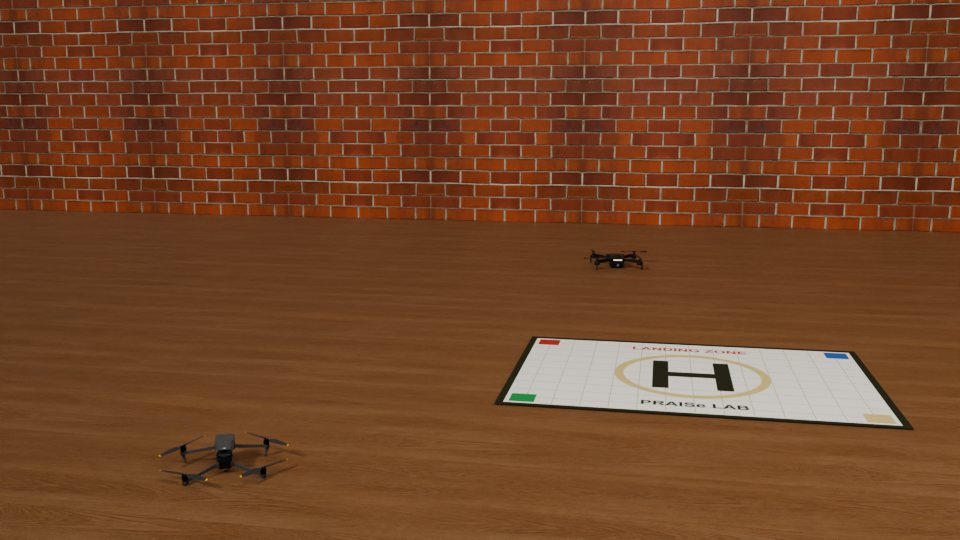
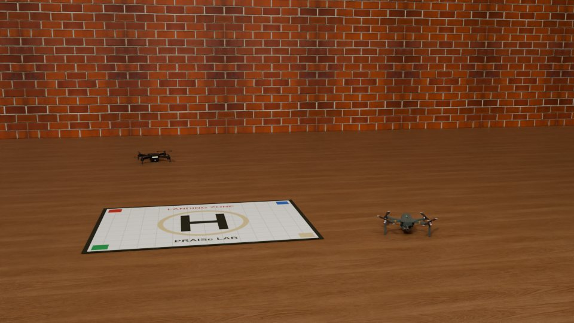

---
# Editable code runs in the reader's browser (Pyodide), not at build time.
engine: markdown
pyodide:
  packages:
    - opencv-python
    - matplotlib
---

# Projections and Transformations {#sec-transformations}

```{=html}
<link rel="stylesheet" href="../assets/transformations.css">
```

A robot rarely looks at the world from just one viewpoint. It moves, it carries several cameras, and it compares what it sees now with what it saw a moment ago. To relate these views it needs a precise language for how points move between them. That language is the subject of this chapter: projections and transformations.

We start with a question cartographers faced centuries ago, then build up the tools step by step: homogeneous coordinates, the family of 2D transformations, homographies, robust estimation with RANSAC, and image warping. The chapter ends by stitching a panorama in your browser.

::: {.callout-note appearance="simple"}
**In this chapter.** Map projections and why every map is wrong · orthographic and perspective projection · vanishing points · homogeneous coordinates · the hierarchy of 2D transformations · homographies and bird's-eye views · estimating a homography · outliers and RANSAC · image warping · panorama stitching.
:::

## Every map is wrong

People knew the Earth was round more than two thousand years ago, yet every flat map of it is distorted. This is not a failure of skill. In 1827 Carl Friedrich Gauss proved, in his *Theorema Egregium* (the "remarkable theorem"), that a sphere cannot be flattened onto a plane without stretching it somewhere. A map can preserve some properties, but never all of them at once.

The Mercator projection, used for navigation since the 16th century, preserves angles, so a constant compass bearing is a straight line on the map. The price is area: Greenland looks about as large as Africa, which is in reality about fourteen times bigger, and Antarctica becomes an endless white band. Other projections preserve area or distances along certain lines and distort something else instead.

This is the central idea of the chapter in miniature. A **transformation** maps points from one space to another, and each kind of transformation preserves some properties and gives up others. Knowing which properties survive tells you what you can and cannot measure after the mapping.

## Orthographic and perspective projection

A camera is itself a projection, from the 3D world to a 2D image. In @sec-image-formation we derived the **perspective** projection of a pinhole camera, $x = fX/Z$. A simpler model, **orthographic** projection, drops the division by depth: $x = sX$. It is what you get from a camera infinitely far away with an infinitely long lens, and it is a good approximation when the depth range of a scene is small compared with its distance.

The difference shows most clearly with parallel lines. Toggle between the two models and tilt the camera.

```{=html}
<div class="sim" id="proj-sim">
  <canvas class="tf__canvas" aria-label="Railway tracks and poles drawn with orthographic or perspective projection"></canvas>
  <div class="sim__controls">
    <span class="sim__group">
      <button type="button" class="btn btn-gold-outline btn-sm is-on" data-mode="persp">Perspective</button>
      <button type="button" class="btn btn-gold-outline btn-sm" data-mode="ortho">Orthographic</button>
    </span>
    <label>Camera pitch <input type="range" name="pitch" min="-5" max="40" step="1" value="15"><output></output></label>
    <label>Focal length <input type="range" name="f" min="150" max="700" step="10" value="360"><output></output></label>
  </div>
  <p class="sim__readout"></p>
</div>
```

Under perspective, lines that are parallel in the world meet in the image at a **vanishing point**. All lines with the same 3D direction share the same vanishing point, and vanishing points of directions parallel to the ground lie on a line, the **horizon**. Vanishing points are useful to robots: they reveal the camera's orientation relative to the ground and can be used to calibrate a camera from a single image.

## Points, vectors and homogeneous coordinates

A point in the image plane is usually written as a pair $(x, y)$. Many transformations are easy to write with matrices: a rotation about the origin is

$$
\begin{bmatrix} x' \\ y' \end{bmatrix} =
\begin{bmatrix} \cos\theta & -\sin\theta \\ \sin\theta & \cos\theta \end{bmatrix}
\begin{bmatrix} x \\ y \end{bmatrix}.
$$

Translation, however, is not a matrix product in this form; it is an addition, $x' = x + t_x$. And the perspective division $x = fX/Z$ is not linear at all. **Homogeneous coordinates** fix both problems with one small trick: add a third coordinate.

The point $(x, y)$ is written as $(x, y, 1)$, and more generally any $(\tilde x, \tilde y, w)$ with $w \neq 0$ represents the point $(\tilde x / w, \tilde y / w)$. Scaling all three entries by the same nonzero factor gives the same point:

$$
(x, y, 1) \sim (2x, 2y, 2) \sim (kx, ky, k).
$$

Geometrically, a point is a ray through the origin of 3D space, and the image is the plane $w = 1$ that the ray pierces. The figure below shows this in one dimension lower: the line $w = 1$ plays the role of the image.

```{=html}
<div class="sim" id="homog-sim">
  <svg class="sim__svg" viewBox="0 0 720 340" role="img" aria-label="Homogeneous coordinates: a ray through the origin meets the line w equals 1"></svg>
  <div class="sim__controls">
    <label>x <input type="range" name="x" min="-2" max="2" step="0.05" value="1.2"><output></output></label>
    <label>w <input type="range" name="w" min="0" max="1.6" step="0.01" value="0.8"><output></output></label>
    <label>Scale k <input type="range" name="k" min="0.3" max="2.2" step="0.05" value="1"><output></output></label>
  </div>
  <p class="sim__readout"></p>
</div>
```

Slide **w** down to zero. The intersection runs off to infinity, yet $(x, 0)$ is a perfectly good homogeneous vector: a **point at infinity**, which represents a direction. This is how projective geometry handles vanishing points and parallel lines meeting "at infinity" without any special cases.

With homogeneous coordinates, translation becomes a matrix product:

$$
\begin{bmatrix} x' \\ y' \\ 1 \end{bmatrix} =
\begin{bmatrix} 1 & 0 & t_x \\ 0 & 1 & t_y \\ 0 & 0 & 1 \end{bmatrix}
\begin{bmatrix} x \\ y \\ 1 \end{bmatrix},
$$

and so does every transformation in the next section. Chains of operations become products of $3 \times 3$ matrices.

## The family of 2D transformations

Every planar transformation in this chapter can be written as $\mathbf{x}' \sim H \mathbf{x}$ with a $3 \times 3$ matrix $H$. Restricting the form of $H$ gives a nested family, from the most constrained to the most general.

::: {.tf__table}
| Transformation | Matrix form | Degrees of freedom | Preserves |
|---|---|---|---|
| Euclidean (rigid) | $\begin{bmatrix} R & \mathbf{t} \\ \mathbf{0}^\top & 1 \end{bmatrix}$ | 3 | lengths, angles, areas |
| Similarity | $\begin{bmatrix} sR & \mathbf{t} \\ \mathbf{0}^\top & 1 \end{bmatrix}$ | 4 | angles, ratios of lengths |
| Affine | $\begin{bmatrix} A & \mathbf{t} \\ \mathbf{0}^\top & 1 \end{bmatrix}$ | 6 | parallel lines, ratios of areas |
| Projective | $\begin{bmatrix} A & \mathbf{t} \\ \mathbf{v}^\top & 1 \end{bmatrix}$ | 8 | straight lines (collinearity) |
:::

Here $R$ is a $2 \times 2$ rotation, $s$ a scale, $A$ any invertible $2 \times 2$ matrix and $\mathbf{v}$ a 2-vector. Each class contains the ones above it and keeps fewer invariants. A projective transformation has 8 degrees of freedom rather than 9 because $H$ and $kH$ describe the same mapping.

Explore the family below. The badge names the most specific class the current matrix belongs to, and the list shows which properties survive. Try the presets, then turn on the perspective terms and watch the parallel red lines start to converge.

```{=html}
<div class="sim" id="transform-sim">
  <div class="tf__layout">
    <canvas class="tf__canvas" aria-label="A square, a letter F, a circle and parallel lines under a 2D transformation"></canvas>
    <div class="tf__side">
      <div class="tp__class"></div>
      <ul class="tp__props"></ul>
      <div class="tp__matrix"></div>
      <p class="tf__legend"><span class="lin">rotation, scale, shear</span><span class="trn">translation</span><span class="prj">projective</span></p>
    </div>
  </div>
  <div class="sim__controls">
    <span class="sim__group">
      <button type="button" class="btn btn-gold-outline btn-sm" data-preset="reset">Reset</button>
      <button type="button" class="btn btn-gold-outline btn-sm" data-preset="euclidean">Euclidean</button>
      <button type="button" class="btn btn-gold-outline btn-sm" data-preset="similarity">Similarity</button>
      <button type="button" class="btn btn-gold-outline btn-sm" data-preset="affine">Affine</button>
      <button type="button" class="btn btn-gold-outline btn-sm" data-preset="projective">Projective</button>
      <button type="button" class="btn btn-gold-outline btn-sm is-on" data-action="grid">Grid</button>
    </span>
  </div>
  <div class="sim__controls">
    <label>Translate x <input type="range" name="tx" min="-150" max="150" step="1" value="0"><output></output></label>
    <label>Translate y <input type="range" name="ty" min="-100" max="100" step="1" value="0"><output></output></label>
    <label>Rotate <input type="range" name="theta" min="-180" max="180" step="1" value="0"><output></output></label>
    <label>Scale <input type="range" name="s" min="0.3" max="1.6" step="0.01" value="1"><output></output></label>
    <label>Stretch x <input type="range" name="aspect" min="0.4" max="2" step="0.01" value="1"><output></output></label>
    <label>Shear <input type="range" name="shear" min="-1" max="1" step="0.01" value="0"><output></output></label>
    <label>Perspective h₇ <input type="range" name="p1" min="-0.003" max="0.003" step="0.0001" value="0"><output></output></label>
    <label>Perspective h₈ <input type="range" name="p2" min="-0.003" max="0.003" step="0.0001" value="0"><output></output></label>
  </div>
</div>
```

### Composing transformations

Because every transformation is a matrix, applying one after another is a matrix product. If $H_1$ is applied first and $H_2$ second, the combined transformation is $H_2 H_1$: the matrix nearest the point acts first. Matrix multiplication is not commutative, so the order matters. Rotating about the origin and then translating is not the same as translating and then rotating.

A common pattern is to rotate an image about its center $\mathbf{c}$ rather than the origin: translate the center to the origin, rotate, and translate back,

$$
H = T(\mathbf{c})\, R(\theta)\, T(-\mathbf{c}).
$$

The cell below builds each class of transformation as a matrix and applies it to a unit square. Change the parameters and run it again.

```{pyodide}
import numpy as np
import matplotlib.pyplot as plt

def T(tx, ty):            # translation
    return np.array([[1, 0, tx], [0, 1, ty], [0, 0, 1.0]])

def R(deg):               # rotation about the origin
    a = np.radians(deg)
    return np.array([[np.cos(a), -np.sin(a), 0], [np.sin(a), np.cos(a), 0], [0, 0, 1.0]])

def S(sx, sy):            # scaling
    return np.diag([sx, sy, 1.0])

square = np.array([[0, 1, 1, 0, 0], [0, 0, 1, 1, 0], [1, 1, 1, 1, 1.0]])  # homogeneous

examples = {
    "Euclidean": T(1.5, 0.3) @ R(30),
    "Similarity": T(1.5, 0.3) @ R(30) @ S(0.6, 0.6),
    "Affine": np.array([[1.2, 0.6, 1.4], [0.1, 0.8, 0.2], [0, 0, 1.0]]),
    "Projective": np.array([[1.0, 0.2, 1.2], [0.1, 1.1, 0.1], [0.35, 0.25, 1.0]]),
}

fig, axes = plt.subplots(1, 4, figsize=(13, 3.4))
for ax, (name, H) in zip(axes, examples.items()):
    p = H @ square
    p = p[:2] / p[2]                      # back from homogeneous coordinates
    ax.plot(square[0], square[1], "--", color="gray", label="original")
    ax.fill(p[0], p[1], alpha=0.3)
    ax.plot(p[0], p[1], lw=2)
    ax.set_title(name)
    ax.set_aspect("equal")
    ax.set_xlim(-0.5, 3); ax.set_ylim(-0.5, 2.5)
plt.show()

# Order matters: rotate-then-translate versus translate-then-rotate
print(np.round(T(1, 0) @ R(90), 3))
print(np.round(R(90) @ T(1, 0), 3))
```

## Homographies

The most general transformation in the family, the projective transformation, is also called a **homography**. It is the one that matters most for cameras, because two situations produce exact homographies between images:

1. **Any plane seen from two viewpoints.** Points on a flat surface, such as a floor, a wall, a road or a sheet of paper, map from one image to another by a homography.
2. **Any scene seen by a camera that only rotates.** If the camera turns about its center without moving, every point in the scene, at any depth, maps by a homography. This is what makes panoramas possible.

A homography maps lines to lines but can turn a rectangle into any quadrilateral. In fact, four points fix it completely. Drag the four corners below: the image follows, and the matrix updates live.

```{=html}
<div class="sim" id="homography-sim">
  <canvas class="tf__canvas tf__canvas--drag" aria-label="An image warped by a homography defined by four draggable corners"></canvas>
  <div class="sim__controls">
    <div class="tp__matrix"></div>
    <span class="sim__group">
      <button type="button" class="btn btn-gold-outline btn-sm" data-action="tilt">Tilt it back</button>
      <button type="button" class="btn btn-gold-outline btn-sm" data-action="reset">Reset</button>
    </span>
  </div>
  <p class="tf__legend"><span class="lin">rotation, scale, shear</span><span class="trn">translation</span><span class="prj">projective</span></p>
</div>
```

### Bird's-eye views

The same idea runs in reverse. If we know where four points of a plane appear in an image, and where they should be on the plane itself, we can compute the homography and **rectify** the image: undo the perspective and see the plane from straight above. Cars do exactly this to build the top-down "surround view" on a parking screen, and lane detectors use it to turn converging lane markings back into parallel lines.

The photo below shows a landing mat on the floor, seen at an angle. Its four colored squares form a rectangle on the mat. Drag the handles onto the colored squares (they start there), or press **Scramble** and try to put them back.

```{=html}
<div class="sim" id="rectify-sim">
  <div class="sim__pair">
    <figure><canvas class="tf__canvas tf__canvas--drag" aria-label="An oblique photo of a landing mat with four draggable handles"></canvas><figcaption>The photo: drag the handles</figcaption></figure>
    <figure><canvas class="tf__canvas" aria-label="The rectified, top-down view of the landing mat"></canvas><figcaption>The rectified, top-down view</figcaption></figure>
  </div>
  <div class="sim__controls">
    <button type="button" class="btn btn-gold-outline btn-sm" data-action="scramble">Scramble</button>
    <button type="button" class="btn btn-gold-outline btn-sm" data-action="reset">Reset</button>
  </div>
</div>
```

Notice that only the mat is rectified correctly. The drones and the far wall are not on the floor's plane, so the homography stretches them. A homography is exact only for the plane it was computed from.

## Estimating a homography

How do we find $H$ from point correspondences? Write the homography as

$$
\begin{bmatrix} x' \\ y' \\ 1 \end{bmatrix} \sim
\begin{bmatrix} h_1 & h_2 & h_3 \\ h_4 & h_5 & h_6 \\ h_7 & h_8 & h_9 \end{bmatrix}
\begin{bmatrix} x \\ y \\ 1 \end{bmatrix},


so that, after dividing by the third coordinate,


x' = \frac{h_1 x + h_2 y + h_3}{h_7 x + h_8 y + h_9},
\qquad
y' = \frac{h_4 x + h_5 y + h_6}{h_7 x + h_8 y + h_9}.
$$

Multiplying out the denominators gives two equations that are *linear* in the unknown entries $\mathbf{h} = (h_1, \dots, h_9)$:

$$
\begin{bmatrix}
-x & -y & -1 & 0 & 0 & 0 & x x' & y x' & x' \\
0 & 0 & 0 & -x & -y & -1 & x y' & y y' & y'
\end{bmatrix} \mathbf{h} = \mathbf{0}.
$$

Each correspondence contributes two rows. With $n$ correspondences we stack them into a $2n \times 9$ matrix $A$ and solve $A\mathbf{h} = \mathbf{0}$ subject to $\lVert \mathbf{h} \rVert = 1$ (since the scale of $H$ is arbitrary). Because $H$ has 8 degrees of freedom, **four correspondences** are the minimum, provided no three of them are collinear. With more than four, the best least-squares solution is the right singular vector of $A$ for its smallest singular value. This is the **Direct Linear Transform (DLT)**. In practice the coordinates are first normalized (centered and scaled) to keep the problem well conditioned.

## Outliers and RANSAC

Correspondences come from feature matching, and feature matching makes mistakes. A single bad match can ruin a least-squares fit, because squared error rewards pulling the solution toward far-away points. Robust estimation is essential.

**RANSAC** (Random Sample Consensus) is the classic answer, and it is beautifully simple:

1. Pick the minimum number of points needed to fit a model, at random (2 for a line, 4 for a homography).
2. Fit the model to just those points.
3. Count the **inliers**: points that agree with the model within a threshold.
4. Repeat many times and keep the model with the most inliers. Finally, refit it to all of its inliers.

Try it on line fitting below. Step through a few iterations, then let it run. Compare RANSAC's answer with ordinary least squares as you raise the fraction of outliers.

```{=html}
<div class="sim" id="ransac-sim">
  <canvas class="tf__canvas" aria-label="RANSAC line fitting with inliers and outliers"></canvas>
  <div class="sim__controls">
    <span class="sim__group">
      <button type="button" class="btn btn-primary btn-sm" data-action="step">One iteration</button>
      <button type="button" class="btn btn-gold-outline btn-sm" data-action="run">Run 40</button>
      <button type="button" class="btn btn-gold-outline btn-sm" data-action="new">New data</button>
    </span>
    <label>Outliers <input type="range" name="out" min="0" max="80" step="5" value="40"><output></output></label>
    <label>Noise <input type="range" name="noise" min="0" max="20" step="1" value="5"><output></output></label>
    <label>Inlier threshold <input type="range" name="thresh" min="2" max="40" step="1" value="12"><output></output></label>
  </div>
  <p class="sim__readout"></p>
</div>
```

How many iterations are enough? If a fraction $e$ of the data are outliers and each sample needs $s$ points, a single sample is all inliers with probability $(1 - e)^s$. To find at least one clean sample with probability $p$, we need

$$
N = \frac{\log(1 - p)}{\log\left(1 - (1 - e)^s\right)}
$$

iterations. For a homography ($s = 4$) with half the matches wrong, $N \approx 72$ for 99% confidence: small enough to run in a few milliseconds.

The cell below estimates a homography from correspondences that include deliberate mistakes, first with plain least squares and then with RANSAC.

```{pyodide}
import cv2
import numpy as np

rng = np.random.default_rng(0)
H_true = np.array([[0.9, 0.15, 30], [-0.1, 1.05, 12], [0.0004, 0.0002, 1.0]])

# 60 points on a plane and their true images
pts = rng.uniform(0, 400, size=(60, 2)).astype(np.float32)
proj = cv2.perspectiveTransform(pts[None], H_true)[0]
proj += rng.normal(0, 0.7, proj.shape)                    # a little noise

# Corrupt 40% of the matches, as a bad feature matcher would
bad = rng.choice(len(pts), 24, replace=False)
proj[bad] = rng.uniform(0, 450, size=(len(bad), 2))

def error(H):
    test = rng.uniform(0, 400, size=(200, 2)).astype(np.float32)
    a = cv2.perspectiveTransform(test[None], H_true)[0]
    b = cv2.perspectiveTransform(test[None], H)[0]
    return np.linalg.norm(a - b, axis=1).mean()

H_ls, _ = cv2.findHomography(pts, proj, 0)                 # all points, least squares
H_rs, mask = cv2.findHomography(pts, proj, cv2.RANSAC, 3.0)

print("Mean error, least squares:", round(error(H_ls), 2), "pixels")
print("Mean error, RANSAC:       ", round(error(H_rs), 2), "pixels")
print("RANSAC kept", int(mask.sum()), "of", len(pts), "matches")
print(np.round(H_rs / H_rs[2, 2], 4))
```

::: {.callout-tip}
## Exercise
Raise the number of corrupted matches in the cell until RANSAC fails. At what outlier fraction does that happen, and how does it change if you lower the reprojection threshold from 3.0 to 1.0?
:::

## Image warping

Once we know a transformation, we can apply it to a whole image. There are two ways to do it.

**Forward mapping** takes each source pixel and sends it to $H\mathbf{x}$. The destination is rarely an exact pixel position, so it must be rounded, and some destination pixels receive no source pixel at all. The result has holes.

**Inverse mapping** works the other way around. For every destination pixel $\mathbf{x}'$, it computes where that pixel came from, $H^{-1}\mathbf{x}'$, and samples the source image there. Every destination pixel gets a value, so there are no holes. The source location usually falls between pixels, so we **interpolate**:

- **Nearest neighbor** takes the closest pixel. Fast, but edges look jagged.
- **Bilinear** interpolation takes a distance-weighted average of the four nearest pixels.
- **Bicubic** interpolation uses sixteen neighbors for smoother results.

Rotate the small patch below and compare the three approaches. The pink checkerboard shows through wherever a destination pixel was left empty.

```{=html}
<div class="sim" id="warp-sim">
  <canvas class="tf__canvas tf__canvas--pixels" aria-label="A small image rotated with forward or inverse mapping"></canvas>
  <div class="sim__controls">
    <span class="sim__group">
      <button type="button" class="btn btn-gold-outline btn-sm is-on" data-mode="forward">Forward</button>
      <button type="button" class="btn btn-gold-outline btn-sm" data-mode="nearest">Inverse, nearest</button>
      <button type="button" class="btn btn-gold-outline btn-sm" data-mode="bilinear">Inverse, bilinear</button>
    </span>
    <label>Rotate <input type="range" name="rot" min="0" max="90" step="1" value="25"><output></output></label>
    <label>Zoom <input type="range" name="zoom" min="0.6" max="2" step="0.05" value="1.15"><output></output></label>
  </div>
  <p class="sim__readout"></p>
</div>
```

Every warp in this chapter, including the homography figures above, uses inverse mapping with bilinear interpolation. OpenCV's `cv2.warpAffine` and `cv2.warpPerspective` do the same.

## Panorama stitching

Everything in this chapter comes together in a panorama. Two photos taken by a camera that turns about its center are related by a homography, so we can:

1. **Detect features** in both images, such as corners or ORB keypoints (the subject of @sec-features).
2. **Match** them by comparing their descriptors, keeping only distinctive matches.
3. **Estimate the homography** with RANSAC, which throws out the wrong matches.
4. **Warp** one image into the other's frame with inverse mapping.
5. **Blend** the overlap so the seam disappears.

The two views below were rendered in Blender from the same camera position, turned 22° between shots. Press **Stitch** to run the whole pipeline in your browser with OpenCV.js.

```{=html}
<div class="sim" id="pano-sim">
  <div class="pano__inputs">
    <figure><figcaption>Left view</figcaption></figure>
    <figure><figcaption>Right view</figcaption></figure>
  </div>
  <div class="sim__controls">
    <button type="button" class="btn btn-primary btn-sm" data-action="stitch">Stitch</button>
    <label class="pano__blend" hidden>Overlap <input type="range" name="blend" min="0" max="100" step="5" value="50"><output></output></label>
  </div>
  <p class="sim__readout">OpenCV.js loads the first time you press Stitch.</p>
  <div class="pano__result" hidden>
    <figure><canvas class="pano__matches"></canvas><figcaption>Feature matches: green inliers, red outliers</figcaption></figure>
    <figure><canvas class="pano__out"></canvas><figcaption>The stitched panorama</figcaption></figure>
  </div>
</div>
```

Move the **Overlap** slider to show either image on top. Where the two agree, the panorama looks the same whichever is on top. A real stitcher also corrects exposure differences between shots and blends gradually across the seam, and for wide panoramas it projects onto a cylinder or sphere instead of a plane, which brings us back to the map makers' problem from the start of the chapter.

::: {.callout-tip}
## Exercise
In a panorama, why must the camera rotate about its own center? Predict what goes wrong if it also moves sideways between shots, using what you know about which scenes produce exact homographies.
:::

## Looking ahead: three dimensions

Everything here generalizes to 3D. Points become $(X, Y, Z, 1)$, and rigid motions become $4 \times 4$ matrices built from a $3 \times 3$ rotation and a translation. Rotations in 3D are richer than in 2D: they do not commute, and they can be described by matrices, axis-angle vectors or quaternions. In @sec-camera-models we combine these 3D transformations with the pinhole model to describe a real camera completely, and learn how to measure its parameters.

## Summary

- No flat map of a sphere preserves everything. Every transformation keeps some properties and gives up others.
- Perspective projection makes parallel lines meet at vanishing points; orthographic projection does not.
- Homogeneous coordinates turn translation and projection into matrix products and represent points at infinity naturally.
- 2D transformations form a hierarchy, Euclidean (3 DOF), similarity (4), affine (6) and projective (8), each preserving fewer invariants.
- A homography relates two views of a plane, or two views from a rotating camera. Four correspondences determine it, and the DLT estimates it from more.
- RANSAC finds models robustly by fitting minimal random samples and keeping the one with the most inliers.
- Inverse mapping with interpolation warps images without holes. Together, these steps stitch panoramas.

::: {.callout-tip}
## Exercises
1. Show that a similarity transformation preserves the ratio of any two lengths. Which property does an affine transformation preserve instead?
2. Write the $3 \times 3$ matrix that rotates an image of size $640 \times 480$ by $30^\circ$ about its center.
3. How many correspondences are needed to estimate an affine transformation? A similarity?
4. In the rectification figure, why do the drones look stretched in the top-down view while the mat looks correct?
5. With 70% outliers, how many RANSAC iterations are needed to find a homography with 99% confidence? How does that compare with fitting a line?
:::

```{=html}
<script src="../demos/opencv-loader.js"></script>
<script src="../demos/transformations.js"></script>
```
